# デジタル掲示板 取扱説明書

バージョン 0.7.0

工場などの「本日の作業内容」ホワイトボードの代わりに、大型のタッチモニタ（と社内LANのほかのPC）で、本日の作業予定・連絡事項・今週の休日出勤予定・災害事例・文書を映すアプリです。
この説明書は、**アプリを自分の職場に入れる担当の方と、毎日の入力をする方**に向けて書いています。入れ方、毎日の使い方、自分の職場の会社名や作業内容への置き換え、困ったときの対処までを順に説明します。

> **ご利用の前に（免責事項）**
> このアプリは「現状有姿」で提供し、作者はいかなる保証もしません。使ったことで生じた損害について、作者は責任を負いません。法令にもとづく記録や、安全にかかわる判断に、このアプリだけを用いないでください（作業予定や災害事例の表示は、確認のための補助です）。画面にある会社名・人名・電話番号・工事名などのサンプルは、すべて架空のものです。

> **この説明書の画面写真について**
> 写真に写っている「サンプル工業(株)」や、人名・電話番号・工事件名は、すべて架空のサンプルです。アプリに付いているサンプルの内容を入れて、パソコンのブラウザ（Microsoft Edge）で撮影しました。写真の日付・時刻は、撮影した日のものです。

> **この説明書で確かめていないこと**
> 写真は、普通のパソコンの画面（1920×1080）で撮りました。**タッチ操作（指での拡大・スワイプ、災害事例の送りボタンの押しやすさ）、70インチのタッチモニタでの見え方、Windows のタッチキーボードが出るか、PC の起動と同時の自動起動は、実機では確かめていません。** また、**リンクボタンで設備点検システムの実際の画面を開いたときの表示と、別のPCから管理者キーを使う操作も、実機では確かめていません。** 該当する場所に「未確認」と書いてあります。実際のモニタで試して、おかしいときは作者へ教えてください。
> 会社と工事件名を「フォルダにファイルを置いて登録する」しくみ（[7章](#7-登録リストを自分の職場に合わせる)）は、自動テストと、付属のサンプルで確かめました（ファイルを足す・書き換える・消す・名前を変えると、画面の候補に反映されること）。実際の職場の登録リストでの運用は、実機では確かめていません。
> `起動.bat` は、開発の確認用に別の場所へコピーして、通常の起動・2回目の起動・ポートが使用中のときの切り替えを実行し、動くことを確かめました。これ以外の場面（実際のモニタのPCなど）では確かめていません。

## 目次

1. [このアプリでできること](#1-このアプリでできること)
2. [用意するもの](#2-用意するもの)
3. [入れ方と起動](#3-入れ方と起動)（ポートの自動切り替えを含む）
4. [画面の見かた](#4-画面の見かた)
5. [毎日の使い方](#5-毎日の使い方)（リンクボタン・ホワイトボード・機器使用予定を含む）
6. [設定（歯車）](#6-設定歯車)
7. [登録リストを自分の職場に合わせる](#7-登録リストを自分の職場に合わせる)（会社と工事件名を、フォルダにファイルを置いて登録する方法を含む）
8. [災害事例PDFの入れ方](#8-災害事例pdfの入れ方)
9. [テロップ（画面の下に流れる文字）](#9-テロップ画面の下に流れる文字)
10. [config.json の項目](#10-configjson-の項目)
11. [他のPCから使う](#11-他のpcから使う)（管理者キーを含む）
12. [バックアップと引っ越し・新しい版への入れ替え](#12-バックアップと引っ越し新しい版への入れ替え)（設定の控えとログを含む）
13. [困ったとき](#13-困ったとき)
14. [付録：用語集](#付録用語集)

---

## 1. このアプリでできること

アプリは、1台のWindows PC（サーバーPC）で動かします。工場のモニタと、社内LANのほかのPCは、ブラウザ（Edge など）でサーバーPCのアドレスを開くだけで同じ画面を見られます。画面は3秒ごとに自動で更新されるので、どこで入力しても、数秒でみんなの画面に反映されます。毎日の入力にログイン（パスワード）はありません。設定の変更だけは、ほかのPCから行うときに「管理者キー」が要ります（[11章](#11-他のpcから使う)）。

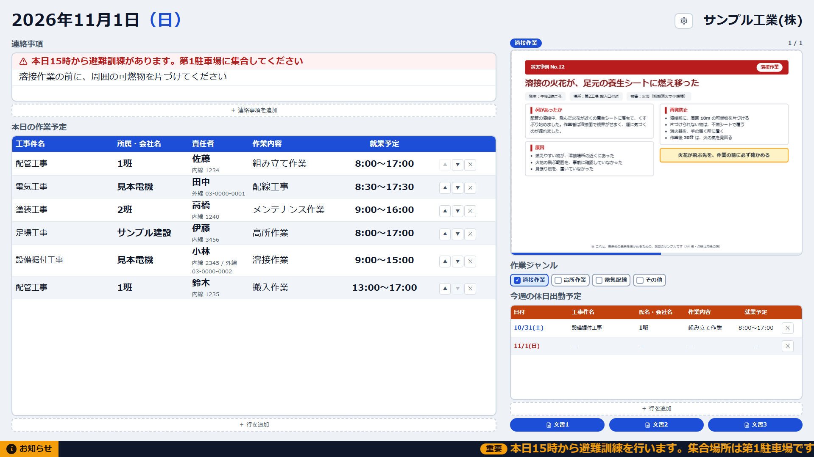

*メイン画面（明るい配色）。*

| 場所 | 名前 | できること |
|---|---|---|
| 左上 | 日付と時刻 | 今日の日付（曜日つき）と、その右に現在の時刻（24時間の「21:33」の形）。右上には歯車ボタンと会社名（設定したときは、その右に責任者と電話番号を1行で）。時刻は、画面を映しているPCの時計で、1分ごとに変わる |
| 左の上段 | 連絡事項 | 自由な文章を3行以上書ける。赤字にもできる |
| 左の中段 | 本日の作業予定 | 工事件名・所属・責任者・作業者数・作業内容・就業時間の一覧。前日の内容を引き継いで始まる |
| 左の下段 | 機器使用予定 | コンプレッサやクレーンなどの機器・所属・使用者・使用予定時間の一覧。毎日、空の2行から始まる（[5-10](#5-10-機器使用予定)） |
| 右の上段 | 災害事例 | 選んだ作業ジャンルの災害事例PDFが、順番に自動で映る。枠は A4 横の形で、大きさは変わらない |
| 右の中段 | 作業ジャンル | 今日の作業にチェックを付けると、その災害事例が映る。3行まで表示する |
| 右の下段 | 今週の休日出勤予定 | 今週の土日祝・会社の休日に出勤する人と作業の一覧。休日の行は、日付だけ入った状態で最初から並ぶ |
| 右下 | リンクボタン | 設備点検システムなど、別のページを掲示板の中で開く（最大2つ。設定したときだけ出ます） |
| 右下 | 文書ボタン | 手順書などのPDFを開く（最大5つ） |
| 右下の一番下 | ホワイトボードボタン | 画面を真っ白なホワイトボードにして、指やペンで描く。カラーのPDFで保存できる（[5-9](#5-9-ホワイトボード)） |
| 画面の一番下 | お知らせ（テロップ） | テキストファイルに書いた文章が、右から左へ流れる |

#### 特徴

- サーバーにするPCは1台だけです。ほかのPCやタブレットには何も入れず、ブラウザで開くだけで使えます。
- 入力は、あらかじめ登録した候補から大きなボタンで選ぶ形です。キーボードがなくても、指で入力できます（連絡事項だけは文字を打ちます）。
- データはすべてサーバーPCの中のファイルに保存します。インターネット上には送りません。
- 夜間（初めの設定では 18:00〜翌 8:00）は、時計だけのスリープ画面になります。
- 4Kのモニタやテレビに映すと、文字を自動で少し小さくして、一覧の行を多く見せます（[4-5](#4-5-4kの画面)）。

---

## 2. 用意するもの

| もの | 内容 |
|---|---|
| サーバーにするPC | Windows 10 または 11。掲示板を使う時間帯は電源を入れたままにします |
| Python | 3.10 以降。入れ方は次の章で説明します |
| ブラウザ | Microsoft Edge（Windows に最初から入っています）。この説明書は Edge で確かめています。ほかのブラウザは未確認です |
| インターネット | 最初のセットアップのときだけ必要です。動かし始めたあとは要りません |
| モニタ | 工場に置く大型モニタ（タッチ式でなくても、マウスで使えます） |

---

## 3. 入れ方と起動

### 3-1. Python を入れる（初めてのときだけ）

1. Python の公式サイト（https://www.python.org/ ）から、Windows 用のインストーラーをダウンロードします。
2. インストーラーを開き、最初の画面の下にある **「Add python.exe to PATH」に必ずチェックを入れて** から「Install Now」を押します。

> **注意**
> 「Add python.exe to PATH」のチェックを忘れると、次の「初回セットアップ.bat」が「Python が見つかりません」と表示して止まります。そのときは Python をもう一度インストールし直して、チェックを入れてください。

### 3-2. アプリを取ってくる

1. GitHub のこのアプリのページ（https://github.com/Nagasaki-Software/digital-bulletin-board ）を開き、右側の「Releases」の下にある、いちばん新しい版（例：「v0.7.0」）を押します。
2. 開いたページの下のほうにある「Assets」から、`digital-bulletin-board-v0.7.0.zip` のような **版数の付いた ZIP** を押してダウンロードします。
3. ダウンロードした ZIP を右クリック →「プロパティ」を開きます。下のほうに「セキュリティ：このファイルは他のコンピューターから取得したものです…」と出ていたら、**「許可する」にチェックを入れて「OK」** を押します。
4. ZIP を右クリック →「すべて展開」で展開します。できたフォルダがアプリのフォルダです。分かりやすい場所へ移し、名前を変えてかまいません。この説明書では `C:\digital-bulletin-board` に置いた前提で書きます。

> **「Source code (zip)」は選ばないでください**
> 同じ「Assets」に並ぶ「Source code (zip)」「Source code (tar.gz)」は、GitHub が自動で付けるものです。開発用のファイルまで入っていて、利用者向けではありません。緑色の「Code」ボタン →「Download ZIP」も同じです。

> **3 の「許可する」について**
> インターネットから取ったファイルには、Windows が「外から来たファイル」という印を付けます。そのまま展開すると、中の `.bat` を開いたときに「Windows によって PC が保護されました」などの警告が出て、止められることがあります。展開する前に「許可する」にしておけば、この警告は出ません。展開したあとで警告が出たときは、「詳細情報」→「実行」で進めます。

> **ヒント**
> OneDrive と同期しているフォルダ（デスクトップなど）は、同期の都合でデータのファイルが一時的に開けなくなることがあるため、避けたほうが安心です。`C:\` の直下のようなフォルダをおすすめします。

### 3-3. 初回セットアップ（初めてのときだけ）

1. アプリのフォルダにある **`初回セットアップ.bat`** をダブルクリックします。
2. 黒い窓が開き、必要な部品を自動でダウンロードします（数分かかります）。
3. 「セットアップが完了しました。」と出たら、何かキーを押して窓を閉じます。

> **「部品のインストールに失敗しました」と出たとき**
> 初回セットアップは、インターネットから部品（Flask・waitress・jpholiday など）をダウンロードします。インターネットにつながるか確かめてください。会社のネットワークが外部への接続を制限している（プロキシなど）と失敗します。つながっているのに失敗するときは、社内の情報システムの担当者に「Python の pip で、pypi.org からダウンロードできるようにしてほしい」と相談してください。

### 3-4. 起動する（毎回）

1. **`起動.bat`** をダブルクリックします。
2. 黒い窓が開きます。掲示板が動き出すのを待って（最大60秒）、いつもの Edge の画面で掲示板が開きます。`起動.bat` は、アプリが書き出す `server_port.txt`（いま使っている番号）を読み、掲示板が答えるのを確かめてから、その番号で Edge を開きます。

> **大切**
> 黒い窓が、アプリの本体です。**使っているあいだは閉じないでください。** 閉じると掲示板が止まり、どの画面も開けなくなります。最小化しておくのはかまいません。
> Edge の画面を閉じても掲示板は止まりません。もう一度開くときは、ブラウザで、黒い窓に出ている `http://localhost:（ポート番号）`（ふつうは `http://localhost:5100`）を開きます。

黒い窓には、次のような文字が出ます。

```
デジタル掲示板を起動します
  このPCで開く: http://localhost:5100
  他のPCで開く: http://（数字のアドレス）:5100
  管理者キー: （英数字の文字列）（他のPCから全端末共通の設定を変えるときに使います）
  終了するときは Ctrl + C を押してください
```

「他のPCで開く」のアドレスは [11章](#11-他のpcから使う) で、「管理者キー」は [11-2](#11-2-管理者キー) で使います。

**全画面にする**：モニタに映すときは、Edge で `F11` キーを押します。ブラウザの枠が消えて全画面になります。もう一度 `F11` で元に戻ります。

**終わるとき**

1. Edge は、ふつうに画面右上の「×」で閉じます（全画面のときは、`F11` で戻してから）。
2. 黒い窓をクリックしてから `Ctrl` キーを押しながら `C` キーを押します。掲示板が止まります。そのあとは窓を閉じてかまいません。

入力した内容は、止めても消えません。次に起動したときに続きから表示されます。

### 3-5. PCの電源を入れたら自動で起動させる

モニタ用のPCなど、毎朝だれかが `起動.bat` を押すのが難しいときは、Windows にサインインしたときに自動で起動するようにできます。

1. `起動.bat` を右クリック →「その他のオプションを確認」→「ショートカットの作成」を押します。
2. キーボードの `Windows` キーを押しながら `R` キーを押し、出てきた欄に `shell:startup` と入力して Enter を押します。「スタートアップ」フォルダが開きます。
3. 1 で作ったショートカットを、このフォルダへ移します。

> **未確認**
> この方法は、実機で確かめていません。設定したあとは、必ず PC を再起動して、掲示板が開くことを確かめてください。また、Windows にサインインしたあとに始まる方法なので、サインイン前から動かしたい場合は別の方法（タスクスケジューラなど）が必要です。

> **PCがスリープしないようにする**
> Windows 本体がスリープすると、掲示板も止まり、ほかのPCから開けなくなります（掲示板の「スリープ画面」＝時計だけの画面とは別のものです）。サーバーにするPCは、「設定」→「システム」→「電源」（ノートPCでは「電源とバッテリー」）→「画面とスリープ」で、スリープを「なし」にしてください。画面だけ消えるのはかまいません。

### 3-6. 初めて起動したときの Windows の確認

初めて起動したとき、Windows が「ファイアウォールでアクセスを許可しますか？」と聞くことがあります。ほかのPCからも使うときは、「プライベート ネットワーク」にチェックを入れて「アクセスを許可する」を押します。許可しないと、ほかのPCから開けません（サーバーPC自身では開けます）。くわしくは [11章](#11-他のpcから使う) を見てください。

### 3-7. ポートの自動切り替えと、2回目の起動

アプリへの入口の番号（ポート）は、**ふつうは 5100** です。ほかのアプリが 5100 番を使っているときは、**5101〜5109 を順に試し、最初に空いていた番号で自動的に起動します**。

- 切り替わったときは、黒い窓に「注意: ポート 5100 は使用中のため、ポート 5101 で起動します」と出ます。実際に使っている番号は、黒い窓の「このPCで開く」「他のPCで開く」のアドレスに出ています。
- `起動.bat` で開く Edge は、自動で実際の番号を開きます。
- ほかのPCからは、黒い窓に出た番号のアドレスで開き直してください。**ファイアウォールの許可や、ほかのPCのブックマークは、基本の番号（5100）で作ったものです。** 番号が切り替わったときは、その番号でも開けるか確かめてください。
- 5100〜5109 のすべてが使用中のときは、エラーが出て起動できません。ほかのアプリを終わらせるか、`config.json` の `server.port` を変えてください（[10章](#10-configjson-の項目)）。
- **すでに掲示板が動いているときに、`起動.bat` をもう一度開くと、新しくは起動しません。** 黒い窓に「すでに起動しています: http://localhost:5100」と出て、動いているほうの掲示板が Edge で開きます（キーを押して、その窓は閉じてかまいません）。

> **注意**
> ほぼ同時に2回押すと、2つ起動してしまうことがあります。黒い窓が2つ開いているときは、片方で `Ctrl` + `C` を押して止めてください。

---

## 4. 画面の見かた

### 4-1. 編集ボタンがあるときと、ないとき

画面には、2つの見え方があります。どちらにするかは、右上の歯車ボタン →「編集ボタン」で、**パソコンごとに** 選びます（[6章](#6-設定歯車)）。

| 見え方 | どんなとき | 特徴 |
|---|---|---|
| 編集ボタン「なし」（初めの設定） | 触った人がすぐ入力できる | 「＋ 行を追加」や ▲▼✕ が、いつも出ている |
| 編集ボタン「あり」 | 工場のモニタなど、誤って触れるおそれがある画面 | 普段は見るだけ。「編集」を押したときだけ入力できる |

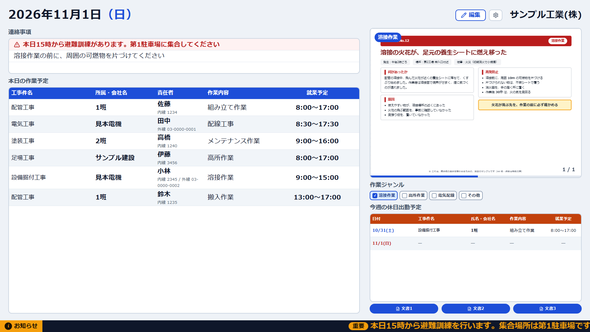

*編集ボタン「あり」の、普段の画面。入力用のボタンが隠れて、一覧が広く見えます。右上に「編集」ボタンが出ています。*

### 4-2. 配色（明るい・暗い）

歯車ボタンから、「明るい」と「暗い」を選べます。これも、パソコンごとの設定です。

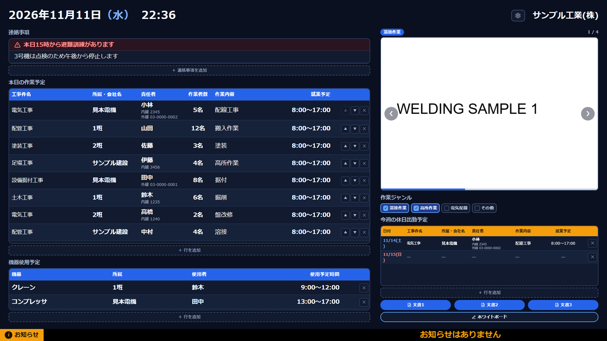

*暗い配色。明るい工場では「明るい」、暗めの場所では「暗い」が見やすいことがあります。*

### 4-3. スリープ画面

夜間（初めの設定では 18:00〜翌 8:00）は、時計と日付だけの**スリープ画面**になります。画面のどこかに触れる（クリックする）と、掲示板に戻ります。戻したあと、5分間（300秒）なにも触れないと、まだ夜間なら、またスリープ画面になります。スリープ画面になるときは、開いていた文書・リンク先と設定の窓は閉じ、災害事例の自動再生は止まります。


*スリープ画面。（撮影用に、時間帯に関係なくスリープ画面を表示して撮りました。）*

- 開始と終了の時刻は、歯車の設定「全端末共通」の「スリープ開始」「スリープ終了」で変えます（[6-2](#6-2-全端末共通)）。**開始と終了を同じ時刻にすると、スリープ画面は出ません。**
- 初めの設定は 18:00 〜 08:00 です。以前の版で作った `config.json` に `"end": "07:30"` と書いてある場合は、その値のまま（07:30）動きます。
- リンク先を開いている間は、スリープ画面には入りません（[5-8](#5-8-リンクボタン)）。
- 設定の項目名は、`config.json` では `standby` のままです（[10章](#10-configjson-の項目)）。

### 4-4. 黄色の警告

画面の上に黄色い帯が出ることがあります。登録リストや `config.json` に問題があるときの知らせです。

| 出る文章の例 | 意味 |
|---|---|
| `config.json の accident_seconds が正しくありません（15秒を使います）` | `config.json` の書き間違い。その項目だけ、初めの値で動いています |
| `data/companies フォルダがありません`（`data/constructions` も同じ） | 会社（工事件名）のフォルダがありません。会社（工事件名）は1つも選べません |
| `見本電機.csv を読めません。Excelで『CSV UTF-8（コンマ区切り）』として保存し直してください` | 会社（工事件名）のファイルの保存形式が違います。そのファイルの会社（工事件名）は選べません |
| `見本電機.csv に列がありません: 責任者` | 1行目の見出しがありません（工事件名のファイルでは `作業内容`）。そのファイルは使われません |
| `data/constructions に、同じ作業内容が2回書かれたファイルがあります（2回目以降は使いません。最初の例: 配管工事.csv の「搬入作業」）` | 同じファイルの中に、同じ作業内容（会社では同じ責任者）が2回あります。2回目以降は使われません |
| `genres.csv が見つかりません` | `data` フォルダに必要な CSV がありません |
| `サーバーに接続できません。再接続しています…` | 黒い窓が閉じたか、ネットワークが切れています。つながり直すと自動で消えます |

登録リストの警告の直し方は [7-8](#7-8-間違えたとき)、そのほかは [13章](#13-困ったとき) にあります。

### 4-5. 4Kの画面

4K（3840×2160）のモニタやテレビに映すと、掲示板は自動で次のように変わります。設定はいりません。

- 文字を、フルHDのときの **85%** の大きさにします。そのぶん、本日の作業予定と今週の休日出勤予定に、多くの行が見えます。
- 連絡事項と機器使用予定を、**3行分** の高さにします（フルHDでは2行分）。

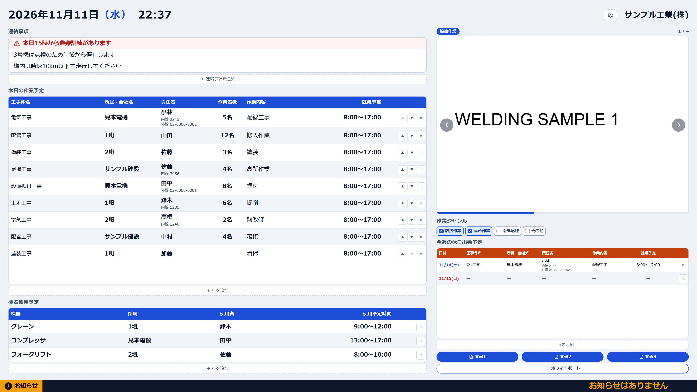

*4K の画面（3840×2160）で映したところ。作業予定の9行がすべて見えて、下にまだ空きがあります。連絡事項と機器使用予定は3行見えます（見本の内容の場合）。*

- 4Kかどうかは、画面の実際の細かさ（横の画素数が3000以上か）で決まります。Windows の「表示」の拡大を 150% や 300% にしていても、4Kとして扱います。
- 同じ掲示板をフルHDのPCで開くと、そのPCではこれまでどおりの大きさです。画面ごとに決まるので、ほかのPCには影響しません。
- 4Kのテレビに映しても文字が大きいままのときは、PC がテレビへ フルHD（1920×1080）で送っています。Windows の「設定」→「システム」→「ディスプレイ」→「ディスプレイの解像度」で 3840×2160 を選んでください。
- 75インチの4Kテレビでの見え方は、実機では確かめていません（未確認）。

---

## 5. 毎日の使い方

### 5-1. 入力の基本

**入力したい欄を指で押します（マウスならクリックします）。** 候補が並んだ大きなボタンの窓が開くので、選ぶ欄の候補を押すと、保存されて窓が閉じます。保存のためのボタンはありません。

- 窓の「クリア」は、その欄を空にします。
- 窓の「閉じる」は、何も変えずに閉じます。
- 保存に失敗すると、画面の下に赤い知らせが数秒出ます。
- **候補に無い言葉を入れたいとき**は、窓の候補の最後にある「**その他（手入力）**」を押します。文字を打つ窓が出るので、**30文字までの1行**で入れて「決定」を押します。手で入れた言葉は、次にその欄を押したとき「その他（手入力）: …」と青く出ます。手入力できるのは、工事件名・所属・会社名・責任者・作業内容・機器・使用者です（時刻と日付は選ぶだけです）。手で入れた責任者には、内線・外線は出ません。

> **編集ボタン「あり」の画面で、押しても何も起きないとき**
> 右上の「編集」を押して、入力できる状態にしてください（[5-7](#5-7-編集ボタンの使い方)）。

### 5-2. 連絡事項

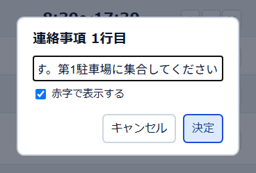

*連絡事項の行を押したところ。*

1. 連絡事項の行を押します。「連絡事項 1行目」のような窓が開きます。
2. 文章を入力します。
3. 目立たせたいときは「赤字で表示する」にチェックを入れます（赤い文字と、行頭の三角マークが付きます）。
4. 「決定」を押します（キーボードなら Enter でも決定できます）。やめるときは「キャンセル」です。

- 連絡事項は、いつも2行分の高さ（4Kの画面では3行分。[4-5](#4-5-4kの画面)）で表示されます。それより多い行は、枠の中をスクロールします。
- 行を増やすには、編集中に出る「＋ 連絡事項を追加」を押します。増やした行は、4行以上あるときだけ「✕」で消せます（3行より少なくはできません）。
- 連絡事項は、**日ごとに空の3行から始まります。** 前の日の連絡事項は引き継がれません。

> **注意：文字を打つときのキーボード**
> 文字を打つのは、連絡事項と、選択窓の「その他（手入力）」です。タッチモニタで Windows のタッチキーボードが自動で出るかは、**実機では確かめていません（未確認）。** 出ないときは、タスクバーのタッチキーボードのボタンを使うか、キーボードをつないでください（[13章](#13-困ったとき)）。

### 5-3. 本日の作業予定

表の下のほうの空白の行を押すと、行が1つ増えて、押した欄の選択窓がそのまま開きます（責任者の欄を押したときは、先に所属・会社名の窓が開きます）。最初に見えている7行がすべて埋まったら、「＋ 行を追加」で行を足します。行の各欄を押して選びます。

| 欄 | 選び方 |
|---|---|
| 工事件名 | 登録した工事件名（`data\constructions` に置いたファイルの名前）から選ぶ |
| 所属・会社名 | 登録した会社名（`data\companies` に置いたファイルの名前）から選ぶ |
| 責任者 | **先に所属・会社名を選びます。** その会社のファイルに書いてある責任者だけが候補に出ます。選ぶと、名前の下に「内線 1234」「外線 03-…」が自動で出ます（両方あるときは2行に分けて出ます） |
| 作業者数 | 押すと数字のボタン（テンキー）が出ます。人数を押して「決定」を押すと、「5名」のように出ます（0〜999。「←」で1字消し、「クリア」で空にします） |
| 作業内容 | **その行の工事件名に合う作業内容だけが候補に出ます**（下の「作業内容は工事件名で絞られます」） |
| 就業予定 | 開始時刻を選び、続けて終了時刻を選ぶ |

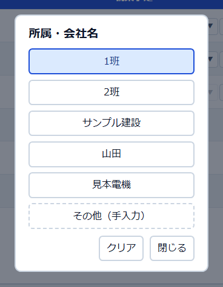

*「所属・会社名」の欄を押したところ。会社名は、`data\companies` フォルダにあるファイルの名前で、ファイル名の順（1班、2班、サンプル建設、山田、見本電機）に並びます。いまの値（1班）が青く出ています。いちばん下の「その他（手入力）」で、候補に無い名前を手で入れられます。*

- 会社を足したいときは、`data\companies` に会社のファイルを置きます（[7-3](#7-3-会社の登録)）。工事件名も同じです（[7-4](#7-4-工事件名と作業内容の登録)）。

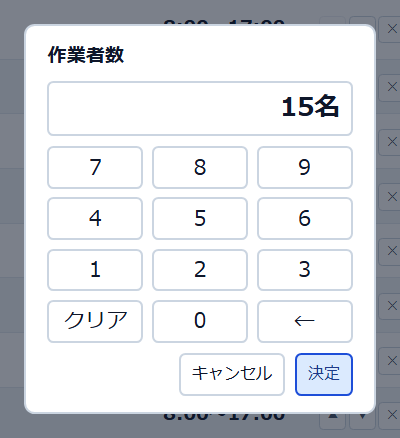

*「作業者数」の欄を押して、1、5 と押したところ。「決定」で「15名」と出ます。*

- 作業者数も、ほかの欄と同じように、次の日に引き継ぎます。

**作業内容は工事件名で絞られます**

- 行の工事件名を選ぶと、同じ行の「作業内容」の候補は、**その工事件名のファイルに書いてある作業内容だけ** になります（ファイルに書いた順。今週の休日出勤予定の表でも同じです）。どれが書いてあるかは、`data\constructions` の中の、その工事件名のファイルで決まります（[7-4](#7-4-工事件名と作業内容の登録)）。

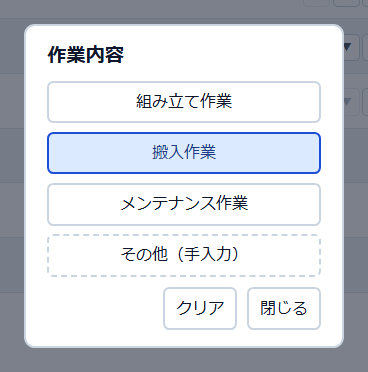

*工事件名が「配管工事」の行で、「作業内容」の欄を押したところ。`配管工事.csv` に書いた3つ（組み立て作業・搬入作業・メンテナンス作業）だけが出ています。いまの値（搬入作業）が青く出ています。*

- **工事件名が空の行や、作業内容を1つも書いていない工事件名の行では、作業内容は全部から選べます**（全部のファイルの作業内容を、重なりを除いてまとめたものです）。書き忘れても、入力できなくなることはありません。
- **工事件名を変えたとき、いまの作業内容が新しい工事件名では選べないものなら、作業内容は自動で空になります**（所属・会社名を変えると責任者が空になるのと同じ仕組みです）。その行の作業内容を、あらためて選んでください。同じ工事件名を選び直しただけなら、作業内容は残ります。
- 候補に無い作業内容は、「その他（手入力）」で入れられます（[5-1](#5-1-入力の基本)）。手で入れた作業内容も、工事件名を変えると自動で空になります。

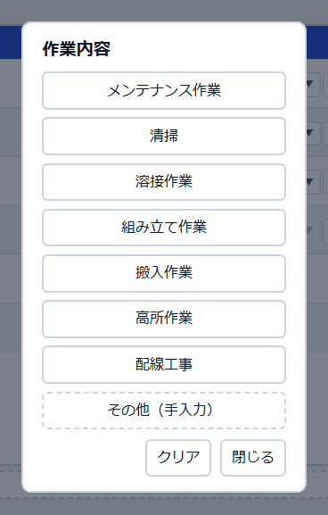

*工事件名が空の行で「作業内容」の欄を押したところ。全部のファイルの作業内容が、まとめて出ます（重なりは1つ。ファイルの名前の順）。*

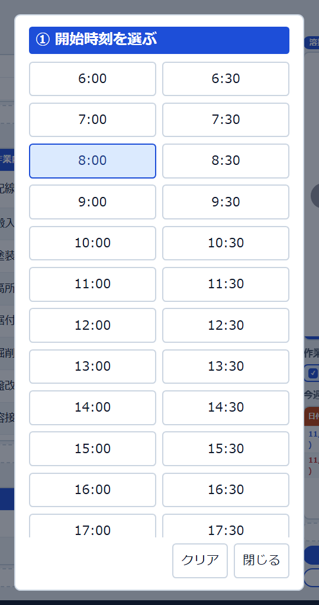

*就業予定の欄を押したところ。まず「開始時刻」、次に「終了時刻」の窓が出ます。窓は下へスクロールできます。*

- 夜勤・徹夜のときは、終了を開始より早い時刻にします（開始 22:00・終了 6:00 など）。画面には「22:00～翌6:00」と、「翌」を付けて出ます。
- 開始時刻で「クリア」を押すと、開始・終了の両方が空になります。
- 所属・会社名を別の会社に変えると、責任者は空に戻ります（会社ごとに責任者が違うため）。
- 行の右にある **▲▼** で行の順番を入れ替えます。**✕** で行を消します（「この行を削除しますか？」と確認が出ます）。消すと、下の行が上に詰まります。


*✕を押したときの確認。「やめる」で戻れます。*

- **前の日の内容が引き継がれます。** 日付が変わって最初に画面を開くと、いちばん最近に入力のあった日の行が、そのまま今日の行になります。変わるところだけ直してください。
- 一覧は、行が少ないときも空白の行を含めて7行分の高さで表示します。多いときは、枠の中をスクロールします。

### 5-4. 今週の休日出勤予定

月曜〜日曜の1週間のうち、土曜・日曜・祝日・会社の休日に出勤する人を入れる一覧です。


*休日出勤予定の表。1行目は入力のある行、2行目は日付だけの行（ほかの欄は「―」）です。*

**休日の行は、最初から並んでいます。** 今週の休日（土曜・日曜・祝日・会社の休日）のぶんだけ、掲示板を最初に表示したときに、1日につき1行が自動で作られます。行には日付だけが入り、ほかの欄は空です。空の欄は、薄い色の「**―**」で表示されます（「―」という文字を入れているわけではなく、中身は空のままです）。

1. 出勤する人の行の、「―」の欄（工事件名・所属・会社名・責任者・作業内容・就業予定）を押します。
2. 作業予定と同じ選択窓が開くので、選びます。「所属・会社名」の候補は、`data\companies` に置いた会社のファイルの名前です（本日の作業予定と同じです）。「責任者」は、**先に所属・会社名を選びます。** その会社のファイルに書いてある責任者だけが候補に出て、選ぶと名前の下に内線・外線が出ます。所属・会社名を別の会社に変えると、責任者は空（「―」）に戻ります。「作業内容」の候補は、同じ行の工事件名に合わせて絞られます（[5-3](#5-3-本日の作業予定)）。工事件名を変えて、いまの作業内容が合わなくなったときは、作業内容は自動で空（「―」）に戻ります。
3. 選んだ欄を空に戻したいときは、窓の「クリア」を押します。「―」の表示に戻ります。

- 同じ日に何人も出勤するときは、編集中に出る「＋ 行を追加」を押します。今週の休日の日付だけが並んだ窓が出るので、日付を選びます。

   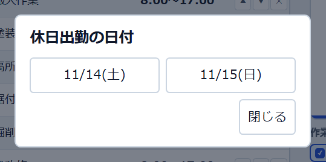

   *日付の窓。今週の休日（この例では土曜と日曜）だけが出ます。日付は「月/日(曜日)」だけで、祝日や会社の休日の名前は出しません（1行に収めるため）。*

- 表の下に空白の行が出ているとき（今週の行が2行より少ないとき）は、空白の行の欄を押しても、休日出勤の行を足せます。今週の休日が2日以上あるときは、先に日付の窓が出ます。行が足されると、押した欄の選択窓がそのまま開きます。
- 日付を変えたいときは、日付の欄を押して選び直します。行を消すときは「✕」です。**消した行は、戻ってきません。**
- 同じ日に、1つでも入力のある行（工事件名・所属・会社名・責任者・作業内容・就業予定のどれかが入っている行）があるときは、最初から並んでいた、その日の「―」だけの行は表示されません。入力のある行をすべて消すと、その日の「―」の行がまた表示されます。
- 「＋ 行を追加」で足した行は、何も入力していなくても、入力するまで表示されます（同じ日に何人も入れるときのために、足した行は隠れません）。不要になった行は「✕」で消します。
- 一覧は、**週ごとに** 切り替わります。月曜になると、先週の行は見えなくなり、その週の休日の行が新しく作られます。週の途中で、会社の休日を `custom_holidays.csv` に足したときは、次に画面が更新されたときに、その日の行が作られます。
- 土曜は青、日曜・祝日・会社の休日は赤で出ます。
- 今週に休日がないときは、行は作られません。編集中に「＋ 行を追加」を押すと、「今週は休日がありません。会社の休日は data/custom_holidays.csv に登録します。」と出ます（[7章](#7-登録リストを自分の職場に合わせる)）。
- 祝日は自動で判別します。会社だけの休日（創立記念日・年末休業など）は、`custom_holidays.csv` に登録します。
- **本日の作業予定の空欄は、これまでどおり空白のままです**（「―」は出ません）。
- 表に見える行数は、作業ジャンルの行数によって変わります（[5-5](#5-5-作業ジャンルと災害事例)）。行が多いときは、表の中をスクロールします。

### 5-5. 作業ジャンルと災害事例


*災害事例の枠と、作業ジャンル。枠のすぐ上の左にジャンルのタグ、右にページ番号（「何枚目／全部で何枚」）が出ます。枠の中には資料と、左右の送りボタン（❮ ❯）が映り、下の端に次へ進むまでの進み具合を示す細い線が出ます。枠は A4 横の形です。*

1. 「作業ジャンル」の中から、今日の作業に当てはまるものを押してチェックを入れます（もう一度押すと外れます）。
2. チェックしたジャンルの災害事例PDFが、決まった秒数（初めの設定は15秒。歯車の設定で変えられます）ごとに、順番に映ります。PDFが複数ページのときは、1ページずつ映ります。
3. 手でめくるには、枠の左右にある **送りボタン** を押します。**右の ❯ で次へ、左の ❮ で前へ** 戻ります。ボタンを押すと、次に自動で進むまでの秒数は数え直しになります。ボタンは、災害事例が映っているときだけ出ます。
4. ボタンのほかに、枠の **右半分を押す** と次へ、**左半分を押す** と前へ戻ることもできます。左右にスワイプしても、めくれます。PDFが複数ページのときは、どの操作でも1ページずつ進み、最後のページの次は次の資料になります。最後の資料の次は、最初の資料に戻ります（ボタンの押しやすさと、指のなぞり方（スワイプ）の操作感は、実機では未確認です）。

- ジャンルのチェックも、**前の日の内容が引き継がれます。**

**災害事例の枠の形と、PDFの向き**

- **災害事例の枠は、A4 横の形（縦横比 297:210）です。** 枠の大きさは、PDFが変わっても、ジャンルが増えても変わりません。
- **横向きの A4 のPDFは、枠にぴったり収まります。** 災害事例のPDFは、横向きの A4（基本の形）で作るのがおすすめです（[8-2](#8-2-pdfの作り方)）。
- 縦向きの A4 のPDFも、全体が見えます。ただし、枠の高さに合わせて小さくなり、左右に余白が出ます。

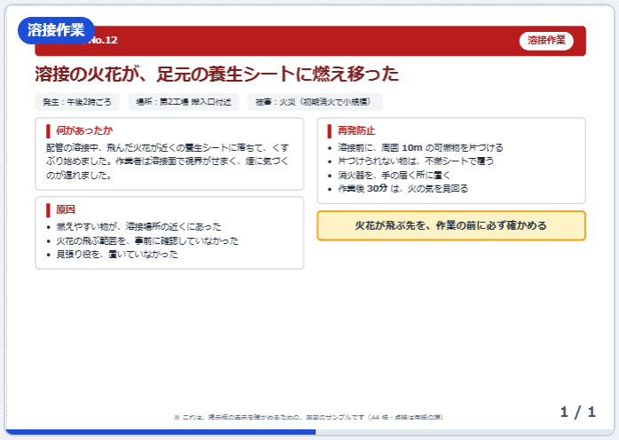

*A4 横のPDFは、枠の上下に余白が出ず、いっぱいに映ります。ジャンルのタグとページ番号は枠のすぐ上に出るので、資料に重なりません。*

**作業ジャンルの行数と、休日出勤予定の表**

- **作業ジャンルの欄は、3行まで表示します。** ジャンルが多くて2〜3行に折り返すと、その分だけ、下の「今週の休日出勤予定」の表が低くなります（枠の大きさは変わりません）。4行以上になると、ジャンルの欄の中をスクロールします。
- 休日出勤予定の表に見える行数は、1920×1080 の画面で、ジャンルが1行なら約4〜5行、2行なら約3行、3行以上（ジャンルの欄がスクロールするとき）も約3行です（いちばん下の行は、途中で切れて見えることがあります）。画面の大きさによって変わります。見えない行は、表の中をスクロールします。

**枠の中に出る文章**

枠の中には、状況に応じて次の文章が出ます。

| 出る文章 | 意味 |
|---|---|
| 作業ジャンルを選ぶと災害事例が表示されます | まだジャンルにチェックが付いていません |
| 該当する災害事例がありません | チェックしたジャンルのPDFが、`accident_cases` フォルダにありません（[8章](#8-災害事例pdfの入れ方)） |
| この資料は表示できません | そのPDFが壊れているなどで開けません。数秒で次の資料へ進みます |

### 5-6. 文書を見る

右下の文書ボタン（初めの設定では「文書1」「文書2」「文書3」）を押すと、そのフォルダにあるPDFの一覧が出ます。

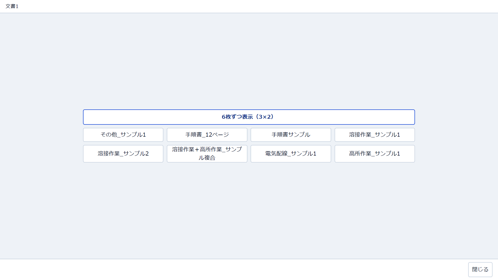

*文書ボタンを押したところ。一覧の名前は、ファイル名から「.pdf」を除いたものです。*

一覧の名前を押すと、PDFが開きます。

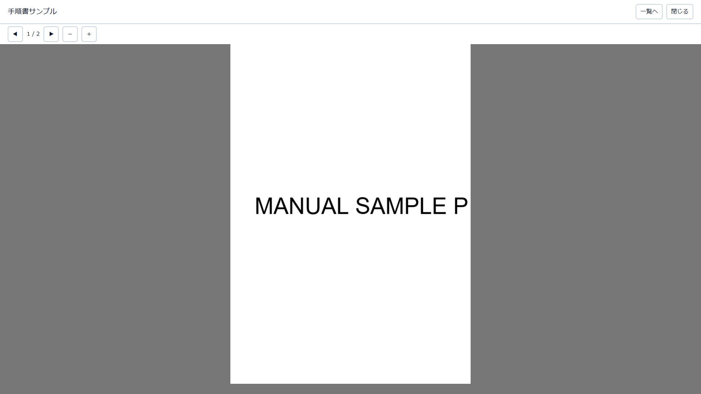

*文書の表示。左上の「◀」「▶」でページをめくり、「－」「＋」で縮小・拡大します。*

- 「一覧へ」で一覧に戻り、「閉じる」で掲示板に戻ります。
- 拡大は、指を広げる操作（ピンチ）か、`Ctrl` キーを押しながらマウスのホイールを回す方法でもできます（ピンチの操作感は、実機では未確認です）。
- **2分間なにも操作しないと、自動で掲示板に戻ります。**（歯車の設定の「文書の操作なし戻り（秒）」で変えられます）
- 文書ボタンの名前・数・フォルダは、歯車の設定で変えます（[6章](#6-設定歯車)）。PDFは、対応するフォルダに入れるだけで一覧に出ます。

**6枚ずつ並べて見る**

フォルダにPDFが2つ以上あるときは、一覧のいちばん上に「**6枚ずつ表示（3×2）**」のボタンが出ます。押すと、フォルダのPDFの1ページ目が、一覧の順に、横3つ×縦2段で並びます。

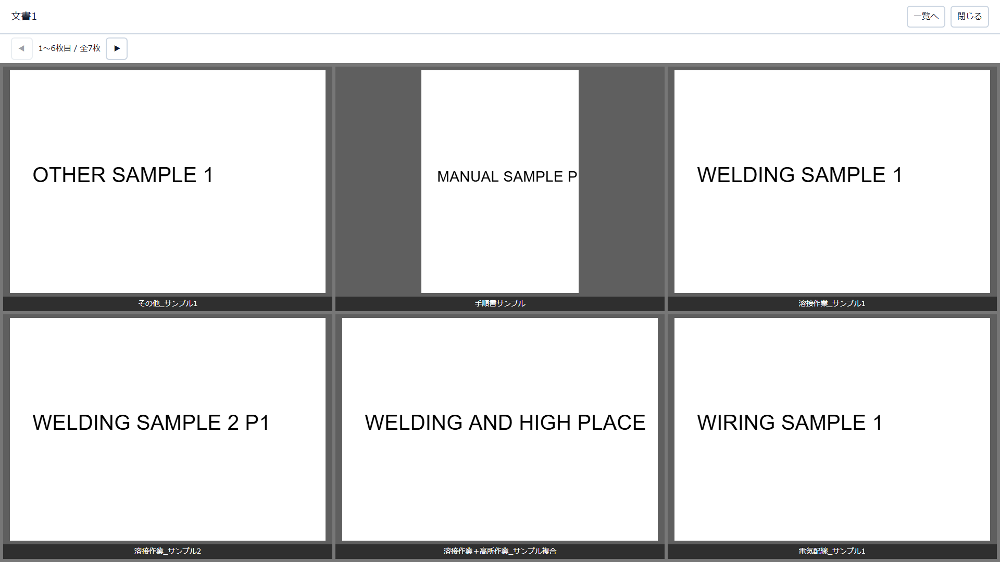

*6枚ずつ表示。上の「◀」「▶」で、次の6つ・前の6つに切り替えます。真ん中に「1〜6枚目 / 全7枚」のように、いま何枚目かが出ます。*

- 並んだPDFを押すと、そのPDFだけが大きく開きます（ページもめくれます）。左上の「戻る」で、並べた表示に戻ります。
- 並べた表示に出るのは、各PDFの**1ページ目だけ**です。2ページ目からは、押して開いてから見てください。
- 6つに足りないところは、空いたままになります。開けないPDFは「表示できません」と出ます。
- 並べた表示の「一覧へ」で、名前の一覧に戻ります。

### 5-7. 編集ボタンの使い方

編集ボタン「あり」の画面（[4-1](#4-1-編集ボタンがあるときとないとき)）では、次のように使います。

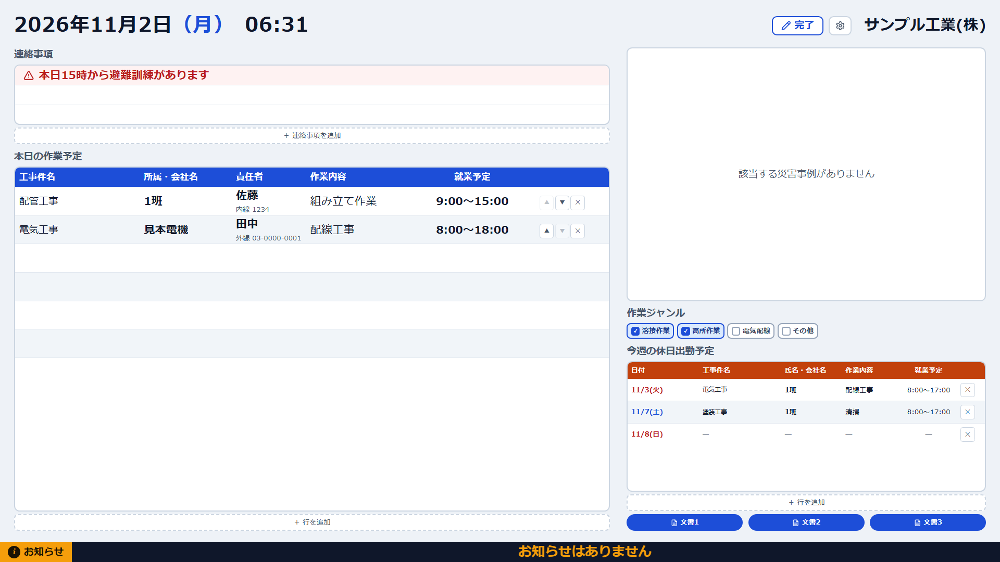

*「編集」を押したあとの画面。ボタンが「完了」に変わり、「＋ 行を追加」や ▲▼✕ が出ています。*

1. 右上の「編集」を押します。入力用のボタンが出て、入力できる状態になります。
2. 必要な入力をします。
3. 終わったら「完了」を押します。見るだけの画面に戻ります。

押し忘れても、**60秒間なにも触れないと、自動で見るだけの画面に戻ります。** 触れるたびに、この60秒は数え直されます（歯車の設定の「編集の自動終了（秒）」で変えられます）。

> **ヒント**
> 編集ボタンは、うっかり触れて入力が変わるのを防ぐためのものです。暗証番号はありません。歯車の設定で「なし」に戻せば、だれでも入力できます。

### 5-8. リンクボタン

文書ボタンの上に、**別のページを掲示板の中で開くボタン**を最大2つ置けます（例：設備点検システム）。ボタンは、設定したときだけ出ます。設定のしかたは [6-2](#6-2-全端末共通) です。

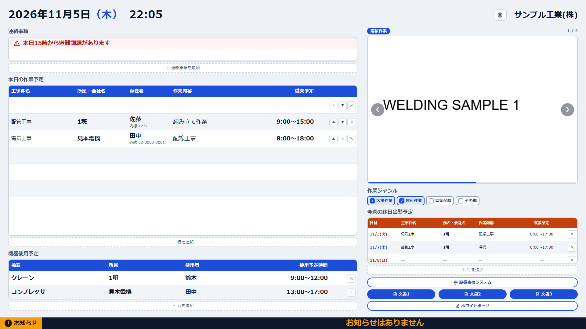

*文書ボタンの上に、リンクボタン「設備点検システム」が出ています。*

ボタンを押すと、掲示板の上に枠が開き、その中にリンク先のページが出ます。

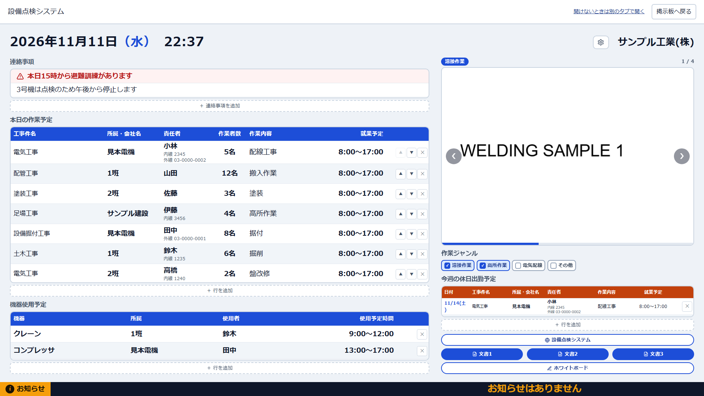

*リンク先を開いたところ。（撮影用に、リンク先には掲示板自身のアドレスを入れました。）上のバーに、ボタンの名前、「開けないときは別のタブで開く」、「掲示板へ戻る」があります。*

- 「**掲示板へ戻る**」を押すと、枠が閉じて掲示板に戻ります。
- リンク先のページによっては、枠の中での表示を許していないことがあります。表示されないときは、「**開けないときは別のタブで開く**」を押すと、別のタブで開きます。
- **開いたまま、最大滞在（初めの設定は300秒）が近づくと、「あと30秒で戻ります」と「続ける」が出ます。** 「続ける」を押すと、最大滞在の最初から数え直します。押さないと、自動で掲示板に戻ります。
- 枠を閉じると、中のページは止まります。リンク先で入力していた内容は残らないので、**保存してから戻ってください。**
- リンク先を開いている間は、スリープ画面には入りません。災害事例の自動再生は止まり、閉じると再開します。文書を開いていたときは、閉じられます。
- リンク先のページを読み込むのは、**この画面を見ているパソコンのブラウザ** です。そのパソコンから、リンク先に届く必要があります。アドレスは `http://サーバーPC名:5000/` のように、サーバーPCの名前かIPアドレスで書いてください（`localhost` と書くと、画面を見ているパソコン自身のことになります）。
- 設備点検システム（equipment-inspection）は、初めの設定ではサーバーPC自身からしか開けません。ほかのPCの掲示板から開くには、設備点検システム側の `config.json` で `server.host` を `0.0.0.0` にし、ファイアウォールでそのポート（既定 5000）を許可する必要があります。また、設備点検システムも使用中のポートによって番号が切り替わります（5001〜）。実際の番号を確かめてください。
- アドレスは `http://` か `https://` で始まるものだけです。

> **未確認**
> 設備点検システムの実際の画面を、この枠の中で開いたときの表示と操作は、実機では確かめていません。写真は、掲示板自身のアドレスを開いて撮ったものです。表示されないときは、「開けないときは別のタブで開く」を使ってください。

### 5-9. ホワイトボード

文書ボタンの下の「**ホワイトボード**」を押すと、画面が真っ白なホワイトボードになります。編集ボタンが「あり」の画面でも、「編集」を押さずに使えます。

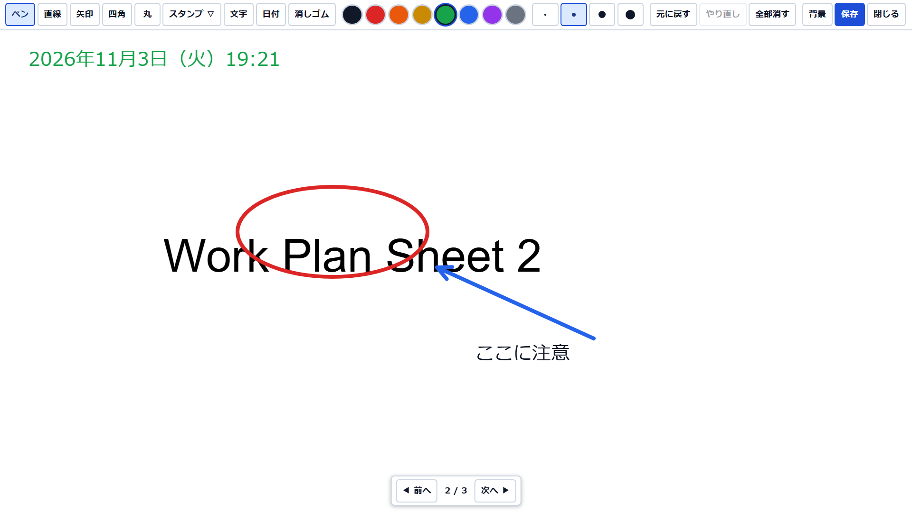

**道具**（画面の上の帯にあります）

| ボタン | はたらき |
|---|---|
| ペン | 指やペンでなぞった線を描く |
| 直線・矢印・四角・丸 | 押した場所からなぞった場所までの形を描く |
| スタンプ | 押した場所を真ん中にして、印を押す。ボタンを押すと ▽ △ ◇ 〇 ☆ ✕ から選べ、ボタンに今の印が出ます。続けて押せばいくつでも押せます |
| 文字 | 押した場所に小さな入力窓が出ます。文字を入れて Enter を押すと、その場所に文字が描かれます（1行だけです） |
| 消しゴム | なぞった所の、描いたものを消す（背景のPDFや工程表は消えません） |
| 色（8色）・太さ（4段階） | 線の色と太さ。太さは「細い・ふつう・太い・帯」の4段階です。**帯**は工程表に期間を引くための太さで、直線で引くと端が角になり、マス目に合わせやすくなります。文字とスタンプは、太さに合わせて4段階の大きさになります（スタンプは、一番細いときで工程表のマスの5割、帯で8割の大きさ） |
| 元に戻す・やり直し | 1つ前に戻す・戻したものをやり直す |
| 全部消す | 描いたものを全部消す（「元に戻す」で戻せます） |

「背景」を押すと、次の窓が出ます。

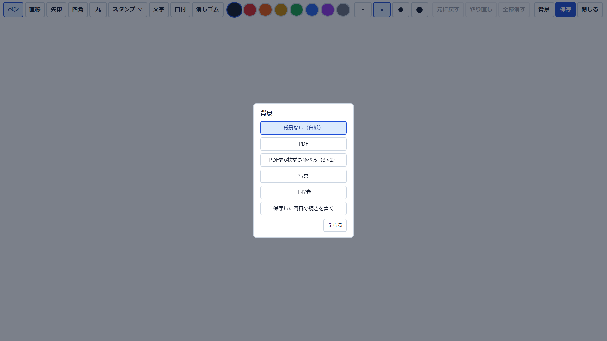

- 描いたものは、描いたあとで動かしたり大きさを変えたりはできません。直したいときは「元に戻す」か消しゴムを使ってください。
- **日付**: 選んでから画面を押すと、その場所に今日の日付と時刻（例 2026年11月3日（火）14:05）が文字で入ります。色・大きさは「文字」と同じ（太さのボタンで4段階）です。
- **背景**: 押すと「背景なし（白紙）」「PDF」「PDFを6枚ずつ並べる（3×2）」「写真」「工程表」「保存した内容の続きを書く」から選びます（工程表は下の「工程表」、6枚ずつ並べるときは下の「PDFを6枚ずつ並べる」を見てください）。PDF・写真は、設定で決めた「背景用のフォルダ」にあるものが一覧に出ます（写真は jpg・jpeg・png）。PDFは**全ページ**が開き、画面の下に出る「前へ・次へ」でページを切り替えて、どのページにも書けます（描いた内容はページごとに残り、「元に戻す」「全部消す」は今のページだけに効きます）。PDFを50ページより多く含む場合は開けません。「保存した内容の続きを書く」は、保存フォルダのPDF（新しい順に60件まで）を背景にして書き足せます（保存した絵は背景になるので、消しゴムでは消せません）。背景の上に描いて、そのまま保存できます。描いた内容が残っているときに、ページ数の違う背景へ替えると「描いた内容は消えます」と確かめます。
- **保存**: 「保存」を押すと、設定で決めた「保存フォルダ」に、**カラーのPDF**ができます。背景のPDFが複数ページなら、**全ページを1つのPDFにまとめて**保存します（白紙・写真は1ページ）。ファイル名は日付と時刻です（例 `2026-11-02_21-30-00.pdf`。同じ秒に2回保存したときは `_2` が付き、上書きしません）。保存すると「保存しました」と出て、画面はそのまま残ります（工程表のときだけは、保存すると白紙に戻ります。下の「工程表」を見てください）。
- **閉じる**: 描いたものを保存していないときは、「保存しないで閉じますか？」と聞きます。
- **保存先に書けないとき**（ネットワークが切れている、書き込みの権限がない、など）は、赤字で「保存できませんでした」と出ます。描いたものは消えないので、保存先を直してから、もう一度「保存」を押してください。
- **なにも触れないとき**: 一定時間（初めは180秒）なにも触れないと、戻る30秒前に「あと30秒で戻ります」と「続ける」が出ます（どこを触っても続けられます）。時間が来ると、**描いてあって、まだ保存していなければ、`…_自動保存.pdf` という名前で自動で保存して**、掲示板に戻ります。白紙のときや、保存したあとに描き足していないときは、保存せずに戻ります。自動保存に失敗したときは、戻らずに画面に残ります。
- 開いている間は、災害事例の自動再生が止まり、スリープ画面にも入りません。閉じると再開します。

**PDFを6枚ずつ並べる**

「背景」→「PDFを6枚ずつ並べる（3×2）」を選ぶと、背景用のフォルダのPDFの**1ページ目**が、一覧の順に、横3つ×縦2段で並びます。それぞれの下に、ファイルの名前が出ます。

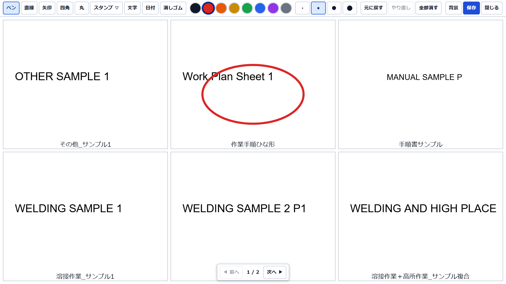

- 7つ目からは、2ページ目に並びます。画面の下の「前へ・次へ」でページを切り替えて、どのページにも書けます。保存すると、全ページが1つのPDFになります。
- 背景のPDFは、ページを切り替えるたびに読み込み直すので、出るまで数秒かかります。
- 並べられるのは300個（50ページ分）までです。それより多いときは「PDFが多すぎます」と出ます。開けないPDFのマスには、赤字で「表示できません」と出ます。

**工程表**

「背景」→「工程表」を選ぶと、開始日と終了日を聞かれます（初めは、今日から24日間）。「決定」を押すと、その期間の工程表が背景に出ます。

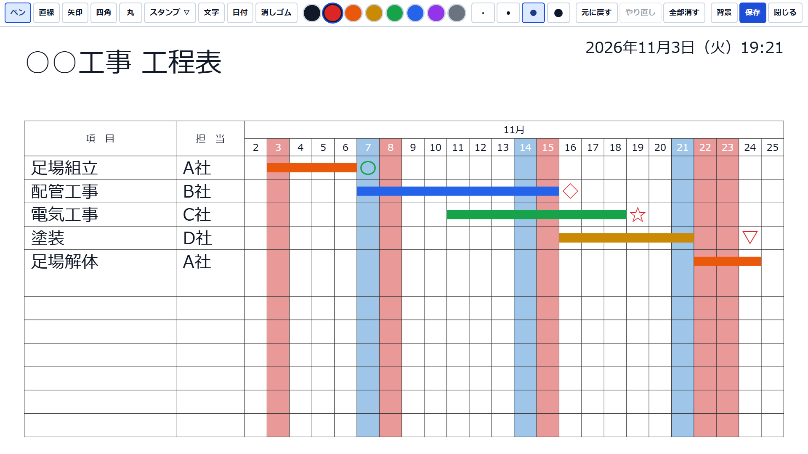

- 表は「項目」「担当」と、日ごとの列でできています。見出しは2段で、上の段に月、下の段に日が出ます。行は12行です。
- **土曜日の列は青、日曜日・祝日・会社の休日（`custom_holidays.csv` に書いた日）の列は赤**になります。
- 表の上は、題名や日付・時刻を書き込めるように、広く空けてあります。右上には、工程表を出した日付と時刻が自動で入ります。
- 工程表は背景なので、消しゴムや「全部消す」では消えません。
- 期間は **62日まで**です。終了日が開始日より前のときや、62日より長いときは、理由を知らせて作りません。日数が多いほど日の列は細くなり、スタンプも列に収まるよう少し小さくなります。
- 期間を引くときは、太さを「帯」にして「直線」で引くと、端が角の帯になります。
- 「保存」を押すと、工程表と書き込んだ内容がPDFになり、**画面は白紙に戻ります**（「保存しました（ファイル名）。工程表を消しました」と出ます）。続きを書きたいときは、「背景」→「保存した内容の続きを書く」で、保存したPDFを背景にして書き足せます。

- 保存フォルダ・背景用のフォルダ・戻るまでの時間は、歯車の設定で変えます（[6-2](#6-2-全端末共通)）。**フォルダは、サーバーPCから見た場所**で書きます（表示しているPCに書き込みの権限は要りません）。`//サーバー名/共有名/ホワイトボード` のようなネットワークの場所も使えますが、サーバーを動かしているWindowsのアカウントに、書き込みの権限が必要です。`Z:` のようなドライブ文字は、自動起動などで見えないことがあるので避けてください。

> **未確認**
> 実物のタッチパネルでの描き心地、画面の文字入力でWindowsのタッチキーボードが出るか、実際のネットワーク共有への保存は、実機では確かめていません。

### 5-10. 機器使用予定

本日の作業予定の下にある表です。コンプレッサやクレーンなど、**機器をだれが・いつ使うか**を入れます。

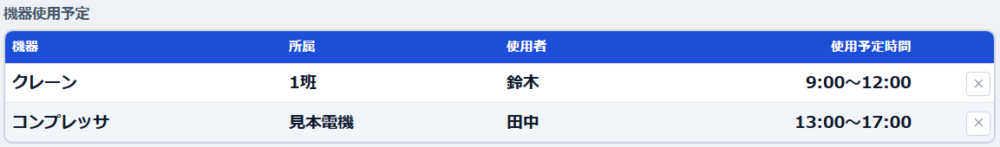

*機器使用予定に2行入れたところ。*

| 欄 | 選び方 |
|---|---|
| 機器 | `data\equipment.csv` に書いた機器の名前から選ぶ（[7-7](#7-7-そのほかのリスト)） |
| 所属 | 登録した会社名（`data\companies` に置いたファイルの名前）から選ぶ |
| 使用者 | **先に所属を選びます。** その会社のファイルに書いてある人だけが候補に出ます |
| 使用予定時間 | 開始時刻を選び、続けて終了時刻を選ぶ（就業予定と同じ） |

- **日ごとに、空の2行から始まります。** 前の日の機器使用予定は、日付が変わると消えます（本日の作業予定とは違い、引き継ぎません）。
- 表は2行分の高さ（4Kの画面では3行分。[4-5](#4-5-4kの画面)）で出ます。それより多いときは、枠の中をスクロールします。行を増やすには「＋ 行を追加」を押します。行の右の **✕** で行を消せます（並べ替えのボタンはありません）。
- 所属を別の会社に変えると、使用者は空に戻ります。
- 機器の候補を足したいときは、`data\equipment.csv` に1行ずつ書き足します（数秒で画面の候補に反映されます）。

---

## 6. 設定（歯車）

画面の右上の歯車ボタンを押すと、設定の窓が開きます。設定は2つに分かれています。窓は長いので、窓の中を上下にスクロールして使います。窓のいちばん下には、アプリの **バージョン**（例：0.7.0）が出ます。

### 6-1. この端末だけ

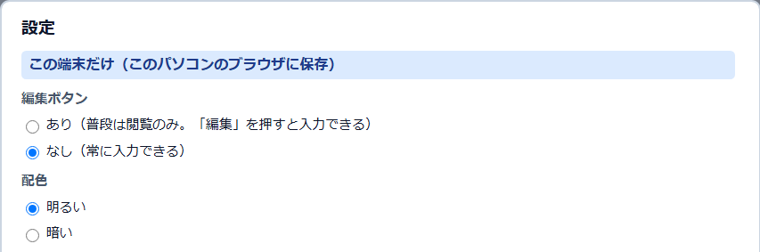

*設定の上の部分。このパソコンのブラウザだけに保存されます。*

| 項目 | 内容 |
|---|---|
| 編集ボタン | 「あり」：普段は見るだけで、「編集」を押すと入力できる。「なし」：いつも入力できる（初めの設定） |
| 配色 | 「明るい」または「暗い」 |

- 選んだ内容は、**そのパソコンの Edge に保存** されます。工場のモニタで選んでも、ほかのPCの設定は変わりません。
- ブラウザの閲覧データを消すと、選んだ内容は初めの設定に戻ります。モニタのPCでは、`config.json` に `default_edit_button` と `default_theme` を書いておくと、保存がないときも決めた状態で始まります（[10章](#10-configjson-の項目)）。
- 同じPCでも、`http://localhost:5100` と `http://（IPアドレス）:5100` のように **開くアドレスが違うと、別のパソコン扱い** になり、設定が別々に保存されます。

> **未確認**
> `起動.bat` で開く普通の Edge で、選んだ設定が再起動後も残るかは、実機で確かめていません。残らないときは、上の `config.json` の方法にしてください。

### 6-2. 全端末共通

サーバーPCの `config.json` に保存され、**どの画面から変えても全部の画面に反映**される設定です。窓が長いので、写真を3つに分けて載せます。

**会社名・お知らせ・会社の休日・データのフォルダ・スリープと時間の設定**

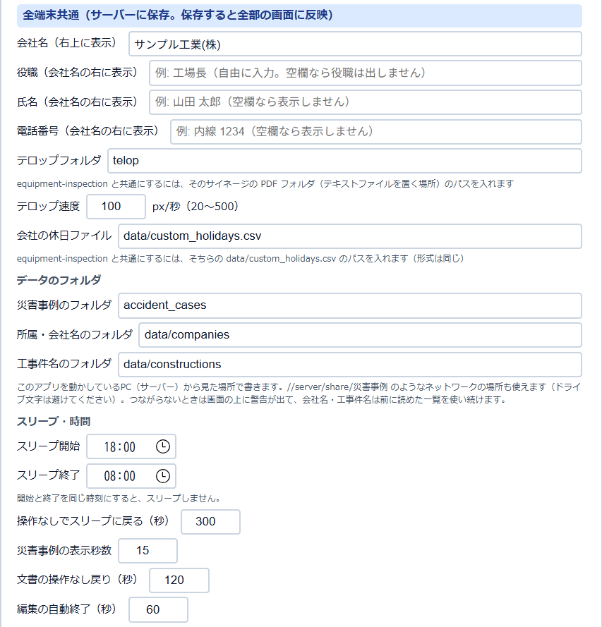

*「全端末共通」の上のほう。（撮影用に、スリープの時刻は初めの設定の 18:00 と 08:00 を表示しています。）*

**文書ボタンとリンクボタンの設定、保存ボタン**

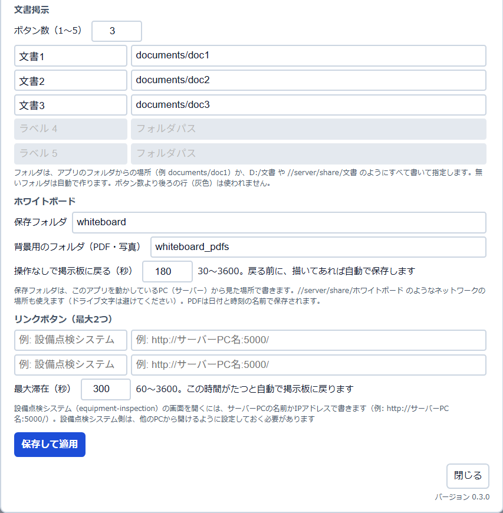

*「全端末共通」の下のほう。いちばん下にバージョンが出ます。*

**データのフォルダ（災害事例・所属・会社名・工事件名）**

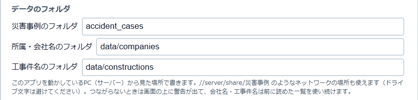

*「会社の休日ファイル」の下にある「データのフォルダ」。何台かの掲示板で、同じ会社名・工事件名・災害事例を使いたいときに、共有フォルダを指定します。*

| 項目 | 内容（文の最後の括弧は、入れられる範囲と初めの値） |
|---|---|
| 管理者キー | **ほかのPCで開いているときだけ出る欄**。サーバーPCでは出ません（[11-2](#11-2-管理者キー)） |
| 会社名（右上に表示） | 画面の右上に出る会社名（1〜100文字。空欄・改行は不可） |
| 役職・氏名・電話番号（会社名の右に表示） | 会社名の右に、「工場長　山田 太郎　電話　内線 1234」のように1行で出ます（それぞれ0〜100文字）。**役職は自由に入力できます**（工場長・所長・安全衛生責任者など）。電話番号も「内線 1234 / 外線 03-…」のように、書き方は自由です。**3つとも空欄なら、何も出ません**（初めは空欄） |
| テロップフォルダ | お知らせの `.txt` を置くフォルダ。空欄なら、アプリのフォルダの中の `telop`（[9章](#9-テロップ画面の下に流れる文字)）（260文字まで） |
| テロップ速度 | 下に流れる文字の速さ（20〜500、初めは100） |
| 会社の休日ファイル | 会社の休日を書いた CSV の場所。空欄なら `data/custom_holidays.csv`。設備点検システムの `data/custom_holidays.csv` と同じ形式（`date,name`）なので、そのパスを入れて共通にできます。掲示板は読むだけで、書き換えません（[7-7](#7-7-そのほかのリスト)）（260文字まで。`..` は不可） |
| スリープ開始・スリープ終了 | 時計だけのスリープ画面にする時間帯（`18:00` のように入れます）。同じ時刻にすると、スリープしません（初めは 18:00 と 08:00） |
| 操作なしでスリープに戻る（秒） | スリープ画面から戻したあと、なにも触れないと、また夜間ならスリープ画面に戻るまでの秒数（1〜86400、初めは300） |
| 災害事例の表示秒数 | 災害事例1枚（1ページ）を映す秒数（1〜86400、初めは15） |
| 文書の操作なし戻り（秒） | 文書を見ていて、なにも触れないと掲示板へ戻る秒数（1〜86400、初めは120） |
| 編集の自動終了（秒） | 編集ボタン「あり」で入力中、なにも触れないと見るだけに戻る秒数（1〜86400、初めは60） |
| 文書掲示 ボタン数 | 文書ボタンの数（1〜5） |
| ラベル 1〜5・フォルダパス | 各文書ボタンの名前と、PDFを入れるフォルダ（名前100文字、場所260文字まで） |
| リンクボタン（最大2つ） | 名前とアドレスを2行まで。名前もアドレスも空の行は使いません。**片方だけだと保存できません**（[5-8](#5-8-リンクボタン)）（名前100文字まで。アドレスは `http://` か `https://` で始まり、500文字まで。空白・`ユーザー名:パスワード@` 付きは不可） |
| 最大滞在（秒） | リンク先を開いたまま、自動で掲示板に戻るまでの秒数（60〜3600の整数、初めは300） |
| 災害事例のフォルダ | 災害事例のPDFを入れる場所（空欄なら、アプリのフォルダの中の `accident_cases`）（260文字まで。`..` は不可。[8章](#8-災害事例pdfの入れ方)） |
| 所属・会社名のフォルダ | 会社のファイルを置く場所（空欄なら `data/companies`）（260文字まで。`..` は不可。[7-1](#7-1-登録のしくみ)） |
| 工事件名のフォルダ | 工事件名のファイルを置く場所（空欄なら `data/constructions`）（260文字まで。`..` は不可。[7-1](#7-1-登録のしくみ)） |
| ホワイトボード 保存フォルダ | ホワイトボードのPDFを保存する場所（空欄なら、アプリのフォルダの中の `whiteboard`。最初に保存するときに作られます）。サーバーPCから見た場所で書きます。`//server/share/ホワイトボード` のようなネットワークの場所も可（260文字まで。`..` は不可。[5-9](#5-9-ホワイトボード)） |
| ホワイトボード 背景用のフォルダ | 背景にするPDF・写真を入れる場所（空欄なら `whiteboard_pdfs`。起動時に自動で作られます）（260文字まで。`..` は不可） |
| 操作なしで掲示板に戻る（秒） | ホワイトボードで、なにも触れないと、自動保存して掲示板へ戻る秒数（30〜3600の整数、初めは180） |

- 変えたら、**「保存して適用」** を押します。**掲示板を止めて起動し直さなくても、数秒で全部の画面に反映されます**（会社の休日ファイルを書き換えたときは、13秒ほどかかります）。
- 時刻は24時間の形（`18:00`）で入れます。入力欄の見え方（12時間表記になるか）は、PCの設定によります（未確認）。
- ボタン数より後ろの行は灰色になって使われません（入力した文字は残り、ボタン数を増やすとまた使えます）。使う行は、ラベルとフォルダパスの両方が必要です。
- フォルダパスは、アプリのフォルダからの場所（例：`documents/doc1`）か、`D:/文書`・`//server/share/文書` のようにすべて書いた場所を指定します。**無いフォルダは自動で作ります**（作れない場所のときは、保存はされ、「作れませんでした」と知らせが出ます）。`..` は使えません。
- 間違いがあるときは、窓の下に赤字で「⚠ ラベル 2 を入力してください」のように出て、何も保存されません。
- データのフォルダは、サーバーPCから見た場所で書きます。`//server/share/会社` のようなネットワークの場所も使えます（ドライブ文字は避けてください）。保存すると、すぐその場所から読みます。**その場所につながらないときは、画面の上に黄色い警告が出ます。** 会社名・工事件名は、前に読めた一覧をそのまま使い続けます（起動したときから読めないときは、候補が空になります）。
- 保存すると、`config.json` のうち、上の項目だけが書き換わります。手で書いたほかの項目は、そのまま残ります。**保存のたびに、変更前の `config.json` の控えが `backups` フォルダに作られます**（[12-5](#12-5-設定の控えbackupsとログlogs)）。
- 上の項目のほかに、`config.json` には、歯車では変えられない項目（配色や編集ボタンの初めの状態、ポート番号など）があります（[10章](#10-configjson-の項目)）。

> **注意（セキュリティ）**
> この設定を変えると、文書ボタンの名前と、見せるフォルダの場所（や、リンクボタンのアドレス）が変わります。**ほかのPCから変えるには、管理者キーが必要**です（サーバーPC自身では要りません。[11-2](#11-2-管理者キー)）。ただし、毎日の入力（作業予定・連絡事項など）にはログインがなく、社内LANにつながったどの端末からでもできます。LANに知らない人がつながる環境では使わないでください。ネットワークの場所（`\\サーバー名\…`）を指定すると、サーバーPCがそこへ接続しに行きます。社内の信頼できる場所だけを指定してください。

---

## 7. 登録リストを自分の職場に合わせる

画面で選べる会社名・責任者・工事件名・作業内容などの候補は、アプリのフォルダの `data` フォルダに入っています。Excel で開いて直せます。**保存すると、掲示板の画面は数秒で自動で反映されます**（掲示板を止める必要はありません）。

アプリに付いている中身は、架空のサンプル（見本電機・配管工事など）です。自分の職場の内容に書き換えてください。

### 7-1. 登録のしくみ

- **会社**は `data` フォルダの中の `companies` フォルダに、**工事件名**は `constructions` フォルダに、**1つの会社（1つの工事件名）につき1つの CSV ファイル**を置いて登録します。
- **ファイルの名前が、そのまま会社名（工事件名）になります。** `見本電機.csv` を置くと、会社の候補に「見本電機」が出ます。会社の一覧表のような、別のファイルはありません。
- 会社のファイルの中には、その会社の**責任者**（と内線・外線）を書きます。工事件名のファイルの中には、その工事件名で選べる**作業内容**を書きます。
- ファイルを置く・書き換える・消すと、数秒で、すべての画面の候補に反映されます。掲示板を止めて起動し直す必要はありません。
- 作業ジャンル・時刻・会社の休日・機器は、これまでどおり、`data` フォルダの1つのファイルに書きます（[7-7](#7-7-そのほかのリスト)）。
- `companies` と `constructions` のフォルダは、歯車の設定の「データのフォルダ」で、共有フォルダなど別の場所に変えられます（[6-2](#6-2-全端末共通)）。何台かの掲示板で同じ一覧を使うときや、事務所のPCで一覧を直したいときに使います。この章の `data\companies`・`data\constructions` は、そのとき設定した場所に読み替えてください。

| 登録するもの | 置く場所 | ファイルの名前 | ファイルの中身 |
|---|---|---|---|
| 会社と責任者 | `data\companies` | 会社名`.csv`（例 `見本電機.csv`） | 責任者・内線・外線（1人1行） |
| 工事件名と作業内容 | `data\constructions` | 工事件名`.csv`（例 `配管工事.csv`） | 作業内容（1行に1つ） |
| 作業ジャンル | `data\genres.csv` | （1つのファイル） | ジャンル名 |
| 就業予定の時刻 | `data\times.csv` | （1つのファイル） | 時刻 |
| 会社の休日 | `data\custom_holidays.csv` | （1つのファイル） | 日付と休日の名前 |
| 機器使用予定の機器 | `data\equipment.csv` | （1つのファイル） | 機器の名前 |

以前の試作版で使っていた、会社・責任者・作業内容・工事件名をそれぞれ1つのファイルにまとめた登録リストは、もう使いません。`data` に残っていても読まれません。

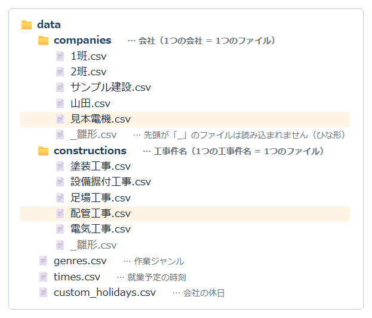

*`data` フォルダの中身（サンプル）。色の付いた2つのファイル（`見本電機.csv` と `配管工事.csv`）は、この章の例で使います。先頭が `_` の `_雛形.csv` は、新しく作るときのひな形です。*

### 7-2. Excel で直すときの注意

> **保存の形式**
> 「名前を付けて保存」で、ファイルの種類を **「CSV UTF-8（コンマ区切り）」** にしてください。ふつうの「CSV（コンマ区切り）」で保存すると、日本語が読めなくなり、画面の上に黄色い警告が出ます。
> 1行目（`責任者,内線,外線` や `作業内容` などの見出し）は、**消したり書き換えたりしないでください。**

- 空の行は無視されます。
- 新しいファイルを作るときは、`_雛形.csv` をコピーして、名前を変える方法が確実です（[7-5](#7-5-会社の-csv-を受け取って置く手順)）。
- ファイルの名前の最後の `.csv` が、エクスプローラーに出ていないことがあります。名前を変えるときに `.csv.csv` や `.txt` にならないよう、拡張子を表示にしておくと安心です（表示の切り替えかたは Windows の版で違います。未確認です）。

### 7-3. 会社の登録

会社は、`data\companies` フォルダに、**会社ごとに1つのファイル** を置きます。ファイルの名前（`.csv` を除いた部分）が会社名です。本日の作業予定の「所属・会社名」と、休日出勤予定の「所属・会社名」の候補になります。

ファイルの中身は、1行目が見出し（`責任者,内線,外線`）、2行目からが責任者（1人1行）です。Excel で `見本電機.csv` を開くと、次のように見えます。

| | A | B | C |
|---|---|---|---|
| 1 | 責任者 | 内線 | 外線 |
| 2 | 田中 | | 03-0000-0001 |
| 3 | 小林 | 2345 | 03-0000-0002 |

*Excel で開いたときの見え方の例です（左端の数字と A・B・C は Excel が付ける行・列の印です）。1行目の見出しは、消したり書き換えたりしないでください。*

メモ帳で開くと、次のとおりです（1行目は見出しです）。

```
責任者,内線,外線
田中,,03-0000-0001
小林,2345,03-0000-0002
```

- 内線と外線は、どちらか一方だけでも、両方空でもかまいません。両方あるときは、画面の責任者の下に「内線 2345 / 外線 03-0000-0002」のように出ます。
- 責任者を選ぶ欄には、**選んだ会社のファイルに書いた人だけ** が出ます。
- **責任者を書かないで、見出しの1行だけのファイル** も、会社として選べます（社内の班などに使えます）。サンプルの `山田.csv` がその例です。この会社を選んで責任者の欄を押すと、候補は「その他（手入力）」だけになります（名前を手で入れられます。内線・外線は出ません）。
- 見出しは、`責任者`・`内線`・`外線` です。古い英語の見出し（`leader_name`・`ext`・`outside`）も読めます。内線・外線の列は、列ごと省いてもかまいません。列の並びは自由です。

### 7-4. 工事件名と作業内容の登録

工事件名は、`data\constructions` フォルダに、**工事件名ごとに1つのファイル** を置きます。ファイルの名前（`.csv` を除いた部分）が工事件名です。ファイルの中には、**その工事件名で選べる作業内容** を、**1列だけ**、1行に1つずつ書きます。Excel で `配管工事.csv` を開くと、次のように見えます。

| | A |
|---|---|
| 1 | 作業内容 |
| 2 | 組み立て作業 |
| 3 | 搬入作業 |
| 4 | メンテナンス作業 |

*Excel で開いたときの見え方の例です。1行目の見出し（`作業内容`）は、消したり書き換えたりしないでください。*

メモ帳で開くと、次のとおりです。

```
作業内容
組み立て作業
搬入作業
メンテナンス作業
```

**画面での働き**

- 行の工事件名を選ぶと、同じ行の「作業内容」の候補が、**その工事件名のファイルに書いた作業内容だけ** になります（ファイルに書いた順に並びます）。**本日の作業予定と、今週の休日出勤予定の、どちらの表でも同じです**（[5-3](#5-3-本日の作業予定)）。
- **工事件名が空の行や、作業内容を1つも書いていない工事件名（見出しだけのファイル）の行では、全部のファイルの作業内容から選べます**（同じ作業内容は1つにまとまり、ファイルの名前の順に並びます）。書き忘れても、入力できなくなることはありません。
- 工事件名を変えたとき、いまの作業内容が新しい工事件名では選べないものなら、作業内容は**自動で空**になります。同じ工事件名のままなら、作業内容は残ります。工事件名を空にしても、作業内容は消えません。
- 候補に無い作業内容は、「その他（手入力）」で入れられます（[5-1](#5-1-入力の基本)）。
- すでに画面に入っている作業内容は、ファイルを書き換えても、勝手には消えません。工事件名を変えたとき（と、ふたたび作業内容を選ぶとき）に、新しい決まりが使われます。
- 見出しは `作業内容` です。古い英語の見出し（`name`）も読めます。
- 同じ作業内容は、どのファイルでも**同じ文字**で書いてください。全角と半角が違うと（例：「A作業」と「Ａ作業」）、別の作業内容として並びます。

### 7-5. 会社の CSV を受け取って置く手順

協力会社（外部の会社）に、その会社の責任者の一覧を CSV で出してもらい、フォルダに置いて登録する手順です。

1. 協力会社に、次のように作ってもらいます。`_雛形.csv`（`data\companies` にあります）をメールなどで渡すと、そのまま書き換えてもらえます。
   - ファイルの名前は、**会社名`.csv`**（例 `見本電機.csv`）にします。
   - 1行目は見出し `責任者,内線,外線`、2行目から責任者を1人1行で書きます。
   - 保存は **「CSV UTF-8（コンマ区切り）」** にします。
2. 受け取ったファイルを、Excel かメモ帳で開き、責任者の名前や番号が合っていること、見出しが残っていることを確かめます。
3. そのファイルを、`data\companies` フォルダに入れます。**同じ名前のファイルがすでにあるときは、上書きすると、責任者の一覧が新しくなります。**
4. 数秒待って、掲示板で「所属・会社名」の欄を押し、その会社が出ること、「責任者」の欄を押して、書いた人が出ることを確かめます。
5. 画面の上に黄色い警告が出たときは、そのファイルを直します（[7-8](#7-8-間違えたとき)）。

- 協力会社との取引をやめるときは、そのファイルを `data\companies` から取り除きます（消す前に、別の場所へ移しておくと、あとで戻せます）。会社の候補から消えますが、すでに画面に入っている行の文字は、そのまま残ります（その行の責任者の内線・外線は出なくなります）。
- 会社名を変えるときは、**ファイルの名前を変えます。** 古い名前は候補から消え、新しい名前の会社として出ます。すでに画面に入っている行は、古い名前のままです。
- 工事件名も同じ手順です。`data\constructions` に「工事件名`.csv`」を入れると、工事件名の候補に出ます。

### 7-6. 決まりと、できないこと

- **読み込まれないファイル**：名前が `~$` で始まるもの（Excel が、ファイルを開いている間に作る一時ファイルです）、`.` や `_` で始まるもの（`_雛形.csv` など）、名前の最後が `.csv` でないもの、`companies`・`constructions` の中にあるフォルダ。これらは、無視されます（警告も出ません）。
- **ファイルの名前に使えない文字があります。** Windows の決まりで、ファイルの名前には `\` `/` `:` `*` `?` `"` `<` `>` `|` が使えません。これらの文字が入る会社名・工事件名は、ファイルを作れないので、登録できません（別の書き方に変えてください）。
- **名前は、ファイルの名前のとおりに使われます。** 全角と半角は別の文字です（例：「Ａ社」と「A社」は別の会社になります）。
- **並び順**：会社も工事件名も、ファイルの名前の順に並びます。数字は数の大きさで比べるので、`1班`・`2班`・`10班` の順になります。それ以外の文字は、文字コードの順です。**ひらがな・カタカナ・漢字は、五十音順にはなりません**（サンプルの会社は、1班・2班・サンプル建設・山田・見本電機の順です）。並び順を変えたいときは、名前の先頭に数字を付けます（その数字も名前の一部になります）。
- **同じファイルの中で、同じ責任者の名前や、同じ作業内容を2回書いたときは、最初の1つだけが使われます。** 2回目以降は使われず、黄色の警告が出ます（責任者は名前だけで見分けるので、内線が違っても、同じ人として扱います）。
- 空の行は無視されます。名前（責任者・作業内容）が空の行も無視されます。

> **未確認**
> Excel でファイルを開いたまま、掲示板がそのファイルを読むときの動きは、実機では確かめていません。上書きして保存したあと、Excel を閉じてください。

### 7-7. そのほかのリスト

#### genres.csv（作業ジャンル）

`data` フォルダの `genres.csv` に、1行に1つ書きます（見出しは `name`）。画面のジャンルのボタンは、ここに書いた順に並びます。ジャンルが多いと、ボタンは2行、3行に折り返して並びます（3行まで表示し、4行以上は欄の中をスクロールします。折り返した行の分だけ、休日出勤予定の表が低くなります。[5-5](#5-5-作業ジャンルと災害事例)）。

> **注意：ジャンル名を変えるとき**
> ジャンルの名前を変えたら、`accident_cases` フォルダの災害事例PDFのファイル名の先頭も、同じ名前に直してください（[8章](#8-災害事例pdfの入れ方)）。直さないと、そのPDFは映りません。また、`genres.csv` から消したジャンルのチェックは、画面に出なくなります。

#### times.csv（就業予定の時刻）

見出しは `time`、1行に1つ、`8:00`・`8:30` のように書きます。**このファイルが無いと、24時間分（6:00から23:30、続けて0:00から5:30）が30分きざみで自動で作られます。** 夜勤の時刻を選べるようにするには、0:00〜5:30 や 22:30 以降の行が入っている必要があります。15分きざみにしたいときなどに書き換えます。

#### equipment.csv（機器使用予定の機器）

見出しは `name`、1行に1つ、機器の名前（`コンプレッサ`・`クレーン` など）を書きます。機器使用予定の「機器」の候補は、ここに書いた順に並びます（[5-10](#5-10-機器使用予定)）。**このファイルが無いと、見本（コンプレッサ・クレーン・フォークリフト・高所作業車）入りのファイルが、起動したときに自動で作られます。**

#### custom_holidays.csv（会社の休日）

祝日は自動で判別されるので、**会社独自の休日だけ** を書きます。

| 列 | 内容 | 例 |
|---|---|---|
| `date` | 日付（年-月-日） | 2026-12-29 |
| `name` | 休日の名前（equipment-inspection と共通の形式のため必要。この掲示板の画面には出ません） | 年末休業 |

```
date,name
2026-12-29,年末休業
```

日付は `2026-12-29` のほか、`2026/12/29`・`2026-1-5` の形も読めます。形が違う行は無視され、画面の上に「custom_holidays.csv の日付が正しくありません」と出ます。このファイルは無くてもかまいません。

**会社の休日ファイルの場所と、設備点検システムとの共通化：** 初めは `data/custom_holidays.csv` を読みます。場所は、歯車の設定「全端末共通」の「会社の休日ファイル」で変えられます。設備点検システム（equipment-inspection）の `data/custom_holidays.csv` と形式（`date,name`）は同じなので、そのパスを入れれば、**2つのアプリで同じ休日を使えます**。掲示板は読むだけで、このファイルを書き換えません。ファイルを直すと、13秒ほどで画面に反映されます。指定した場所にファイルが無いときは、黄色の警告「会社の休日ファイル（…）が見つかりません」が出ます。

### 7-8. 間違えたとき

| 間違い | どうなるか |
|---|---|
| ファイルの名前の最後が `.csv` でない（`.csv.csv`・`.txt` など）。名前が `_`・`.`・`~$` で始まる | 読み込まれない（警告は出ない）。会社・工事件名の候補に出ない |
| 保存の形式が違う（文字化け） | 黄色の警告「○○.csv を読めません。Excelで『CSV UTF-8…』として保存し直してください」が出る。そのファイルの会社・工事件名は選べない |
| 1行目の見出しを消した・書き換えた（会社は `責任者`、工事件名は `作業内容`） | 黄色の警告「○○.csv に列がありません: 責任者」が出る。そのファイルは使われない |
| ファイルが空（何も書いていない） | 黄色の警告「○○.csv が空です。1行目に見出し（責任者）が必要です」が出る。そのファイルは使われない |
| 同じファイルの中で、同じ責任者・同じ作業内容を2回書いた | 最初の1つだけ使われる。黄色の警告「data/companies に、同じ責任者が2回書かれたファイルがあります（2回目以降は使いません。最初の例: …）」が1件出る（工事件名は「同じ作業内容が2回書かれた…」） |
| `companies` や `constructions` のフォルダが無い | 黄色の警告「data/companies フォルダがありません」が出る。会社・工事件名は選べない |
| `genres.csv` が無い | 黄色の警告「genres.csv が見つかりません」が出る。ジャンルは選べない（`times.csv`・`custom_holidays.csv` は、無くても警告は出ない） |
| 会社のファイルを消した・名前を変えた | 候補から消える。すでに画面に入っている行の表示は、そのまま残る。その行の責任者の内線・外線は出なくなる |
| 責任者を、会社のファイルから消した | 画面の名前は残るが、内線・外線の番号は出なくなる |
| 作業内容を、工事件名のファイルから消した | すでに画面に入っている行の表示は、そのまま残る。新しくは選べなくなる |

警告は、見つかった最初の1つだけを書きます。直して保存すると、数秒で消えます。

### 7-9. 使い始める前のチェックリスト

本番で使い始める前に、上から順に確かめてください。

| | 確かめること | 参照 |
|---|---|---|
| □ | `data\companies` に、自分の職場の会社・班のファイルを置いた（サンプルのファイルは、使わないなら別の場所へ移すか、書き換えた）。責任者と内線・外線を入れた | [7-3](#7-3-会社の登録) |
| □ | 協力会社から CSV を受け取って置く手順を、担当の人が分かっている | [7-5](#7-5-会社の-csv-を受け取って置く手順) |
| □ | `data\constructions` に、自分の職場の工事件名のファイルを置き、その工事件名で選べる作業内容を入れた | [7-4](#7-4-工事件名と作業内容の登録) |
| □ | `genres.csv` を自分の職場の内容にした | [7-7](#7-7-そのほかのリスト) |
| □ | `custom_holidays.csv` に、会社独自の休日を入れた（祝日は不要） | [7-7](#7-7-そのほかのリスト) |
| □ | 画面の上に黄色の警告が出ていない | [7-8](#7-8-間違えたとき) |
| □ | 歯車の設定で、会社名を入れた | [6章](#6-設定歯車) |
| □ | 災害事例のPDFを入れ、ジャンルのチェックで映ることを確かめた | [8章](#8-災害事例pdfの入れ方) |
| □ | 文書ボタンの名前とフォルダを決め、PDFを入れた | [6章](#6-設定歯車) |
| □ | お知らせの文章を `telop` フォルダに入れた | [9章](#9-テロップ画面の下に流れる文字) |
| □ | 工場のモニタで、編集ボタンの「あり」「なし」と配色を選んだ | [4章](#4-画面の見かた) |
| □ | リンクボタンを使う場合は、名前とアドレスを入れ、開けることを確かめた | [5-8](#5-8-リンクボタン) |
| □ | ほかのPCから開けることを確かめた（使う場合）。管理者キーを控えた | [11章](#11-他のpcから使う) |
| □ | PCがスリープしない設定にし、必要なら自動起動を設定した | [3-5](#3-5-pcの電源を入れたら自動で起動させる) |
| □ | バックアップの方法（どこへ、いつコピーするか）を決めた。`data` フォルダは、中の `companies`・`constructions` も一緒にコピーする | [12章](#12-バックアップと引っ越し新しい版への入れ替え) |

---

## 8. 災害事例PDFの入れ方

災害事例のPDFは、アプリのフォルダの **`accident_cases`** フォルダに入れます（無ければ、起動したときに自動で作られます）。フォルダの場所を変えたいときは、`config.json` の `accident_folder` を書き換えます（[10章](#10-configjson-の項目)）。

### 8-1. ファイル名の決まり

**ファイル名の先頭が作業ジャンル名** です。次の形にします。

```
ジャンル名_内容.pdf
```

| 例 | 意味 |
|---|---|
| `溶接作業_事例A.pdf` | 「溶接作業」にチェックが付いたときに映る |
| `溶接作業＋高所作業_事例B.pdf` | 「溶接作業」か「高所作業」のどちらかにチェックが付いたときに映る（1回だけ映ります。重ねては映りません） |

- ジャンル名と内容は、半角のアンダーバー（`_`）で区切ります。
- 複数のジャンルに当てはまる事例は、ジャンル名を `＋`（全角でも半角でも可）でつなぎます。
- **`genres.csv` にない名前のファイルは映りません。** ジャンル名は、`genres.csv` と同じ文字にしてください。
- 並びの順は、`genres.csv` のジャンルの順です。同じジャンルのなかは、ファイル名の順です。

### 8-2. PDFの作り方

- 複数ページのPDFは、1ページずつ順に映ります。
- **横向きのA4（基本の形）で作るのがおすすめです。** 災害事例の枠は、A4 横の形（縦横比 297:210）になっているので、横向きのA4のPDFは、上下に余白が出ず、枠いっぱいに映ります。
- 縦向きのA4でも映ります。全体が見えますが、枠の高さに合わせて小さくなり、文字も小さく映ります。左右に余白が出ます。
- そのほかの大きさ（A3 など、縦横の比が違うもの）も映りますが、枠の形と違う分だけ、余白が出ます。
- **資料の全体が、そのまま見えます。** 選んでいる作業ジャンルを示す青いタグ（「溶接作業」など）と、ページ番号（「1 / 2」）は、枠の **すぐ上** に出ます（タグは左、ページ番号は右）。資料の上には何も重ならないので、端の近くまで文字を置いても隠れません。枠の下の端に、次へ進むまでの進み具合を示す細い線が出るだけです。
- PDFを入れたり差し替えたりすると、数秒で反映されます（掲示板を止める必要はありません）。

---

## 9. テロップ（画面の下に流れる文字）

画面の一番下に、「お知らせ」の文字が右から左へ流れます。文章は、**テキストファイル** に書きます。Excel は要りません。メモ帳で書いて、拡張子を `.txt` にして保存するだけです。


*画面の一番下。左の「お知らせ」の札の右に、文章が流れます。オレンジの丸い札（バッジ）は、文章の一部を `"` で囲んだものです。*

### 9-1. 書き方

アプリのフォルダの `telop` フォルダ（無ければ起動時に自動で作られます）に、`.txt` ファイルを置きます。

```
"重要"本日15時から避難訓練を行います。集合場所は第1駐車場です
"連絡"12月29日から年末休業です
ご安全に。指差呼称を忘れずに
```

- フォルダの中の `.txt` を、**ファイル名の順** にすべて読みます。ファイルはいくつ置いてもかまいません。
- **1行が1件のお知らせ** です。空の行は無視されます。件と件のあいだは、広くあけて流れます。
- 文章の一部を `"` で囲むと、そこだけオレンジ色の丸い札（バッジ）になります。全角の `＂` や、カーブした `“` `”` も使えます。閉じ忘れなど、対になっていない引用符は、ふつうの文字のまま出ます。
- 文字コードは、メモ帳の標準の UTF-8 でも、Shift-JIS（ANSI）でも、UTF-16（メモ帳の「Unicode」）でも読めます。
- 流す件数は全部で200件までです。1件は500文字までで、超えた分は切れます。**1MB を超える大きなファイルは読まれません。**
- ファイルを保存すると、数秒で画面に反映されます。
- お知らせが1件もないときは「お知らせはありません」と流れます。
- スリープ画面・設定・文書やリンク先の閲覧のときは、テロップは、その下に隠れます。

流れる速さ（テロップ速度）と、お知らせを置くフォルダは、歯車の設定「全端末共通」で変えます（[6章](#6-設定歯車)）。

### 9-2. 設備点検システム（equipment-inspection）と同じお知らせを使う

同じ作者の姉妹アプリ「設備点検システム（equipment-inspection）」のサイネージも、フォルダの中の `.txt` を1行1件で読みます（形式は上と同じです）。**同じフォルダを指定すれば、2つのアプリで同じお知らせが流れます。**

1. 設備点検システムのサイネージで、お知らせの `.txt` を置いているフォルダ（PDF フォルダ）の場所を調べます。
2. デジタル掲示板の歯車 →「全端末共通」→「テロップフォルダ」に、その場所を入れて「保存して適用」を押します。

> **注意**
> 2つのアプリが **同じファイルを読む** ので、片方のために直した行は、もう片方にも出ます。別々にしたいときは、フォルダを分けてください。デジタル掲示板が読むのは、そのフォルダの `.txt` だけです。PDF やほかの種類のファイルは無視されます。ネットワーク上のフォルダを指定するときは、信頼できる場所だけにしてください（[6章](#6-設定歯車) の注意）。

---

## 10. config.json の項目

`config.json` は、アプリのフォルダに置く設定ファイルです。**無くても、初めの設定で動きます。** 変えたい項目があるときだけ書きます。歯車の設定で「保存して適用」を押すと、このファイルは自動で作られ（または書き換えられ）ます。

メモ帳で開いて直します。保存のときは、文字コードを **「UTF-8」** にしてください。直したら、掲示板を止めてもう一度起動します（歯車の設定から保存した項目だけは、起動し直さなくても反映されます）。

例（会社名と、災害事例の表示秒数だけ変える）：

```
{
  "company_name": "株式会社〇〇",
  "accident_seconds": 20
}
```

| 項目 | 初めの値 | 内容 |
|---|---|---|
| `company_name` | サンプル工業(株) | 画面右上の会社名（1〜100文字）。歯車の設定でも変えられます |
| `default_edit_button` | off | 編集ボタンの初めの状態（`on` か `off`）。そのパソコンで歯車から選んだ値があれば、そちらが優先されます |
| `default_theme` | light | 配色の初めの状態（`light` か `dark`）。そのパソコンで選んだ値があれば、そちらが優先されます |
| `accident_folder` | accident_cases | 災害事例PDFのフォルダ。歯車の設定でも変えられます |
| `accident_seconds` | 15 | 災害事例1枚（1ページ）を映す秒数。歯車の設定でも変えられます |
| `documents.buttons` | 文書1〜3 | 文書ボタン（最大5つ。ボタンごとに `label` と `folder` を書く）。歯車の設定でも変えられます |
| `documents.idle_return_seconds` | 120 | 文書を見ていて、操作がないときに掲示板へ戻る秒数。歯車の設定でも変えられます |
| `telop.folder` | telop | お知らせの `.txt` を置くフォルダ。歯車の設定でも変えられます |
| `telop.speed` | 100 | お知らせの流れる速さ（20〜500の整数）。歯車の設定でも変えられます |
| `edit_lock_seconds` | 60 | 「編集」で入力中、操作がないときに見るだけに戻る秒数。歯車の設定でも変えられます |
| `standby.start` / `standby.end` | 18:00 / 08:00 | スリープ画面にする時間帯（`18:00` の形で書く。項目名は `standby` のまま）。歯車の設定でも変えられます |
| `standby.wake_idle_seconds` | 300 | スリープ画面から戻したあと、操作がないときにスリープに戻る秒数。歯車の設定でも変えられます |
| `server.host` | 0.0.0.0 | 掲示板が受け付けるアドレス。`0.0.0.0` はほかのPCからも、`127.0.0.1` にすると、このPC自身からだけ開けます（`:` を含む値は使えません）。**起動時に1回だけ読むので、変えたら起動し直します** |
| `server.port` | 5100 | 基本のポート番号（1024〜65526）。使用中なら 5101〜5109 を順に試します（[3-7](#3-7-ポートの自動切り替えと2回目の起動)）。**変えたら起動し直します** |
| `custom_holidays_file` | data/custom_holidays.csv | 会社の休日ファイルの場所。歯車の設定でも変えられます（[7-7](#7-7-そのほかのリスト)） |
| `companies_folder` | data/companies | 会社のファイル（会社1つにつき1ファイル）を置くフォルダ。歯車の設定でも変えられます（[7-1](#7-1-登録のしくみ)） |
| `constructions_folder` | data/constructions | 工事件名のファイル（工事件名1つにつき1ファイル）を置くフォルダ。歯車の設定でも変えられます（[7-1](#7-1-登録のしくみ)） |
| `links.items` | （なし） | リンクボタン（最大2つ。ボタンごとに `label` と `url` を書く）。歯車の設定でも変えられます |
| `links.max_stay_seconds` | 300 | リンク先を開いたまま自動で戻る秒数（60〜3600の整数）。歯車の設定でも変えられます |
| `whiteboard_save_folder` | whiteboard | ホワイトボードのPDFを保存するフォルダ。歯車の設定でも変えられます |
| `whiteboard_pdf_folder` | whiteboard_pdfs | ホワイトボードの背景に使うPDF・写真（jpg・png）を入れるフォルダ。歯車の設定でも変えられます |
| `whiteboard_idle_seconds` | 180 | ホワイトボードで操作がないとき、自動保存して掲示板へ戻る秒数（30〜3600の整数）。歯車の設定でも変えられます |

- **以前の版の `config.json` について：** スリープ終了の初めの値は、以前の 07:30 から 08:00 に変わりました。すでに `"standby": {"end": "07:30"}` と書いてある `config.json` は、その値のまま動きます（変えたいときは、書き換えるか、歯車の設定で保存し直します）。
- **ポートとホスト：** `server.host` と `server.port` は、歯車では変えられません。メモ帳で書いて、掲示板を起動し直します。例：`{"server": {"port": 5200}}`
- **フォルダの場所の書き方：** `/` で区切るか（例：`D:/掲示板/災害事例`）、`\\` のように2つ重ねます（例：`D:\\掲示板\\災害事例`）。`\` を1つだけ書くと、書き間違いになります。
- **秒数** は、1 以上 86400 以下の数字で書きます。
- **書き間違いがあるとき：** その項目だけ、初めの値を使って起動し、画面の上に黄色い警告が出ます（例：「config.json の accident_seconds が正しくありません（15秒を使います）」）。`config.json` を直して、掲示板を起動し直してください。
- 文書ボタン・リンクボタンの `label` や会社名などの文字は100文字まで、フォルダの場所は260文字まで、リンクのアドレス（`url`）は500文字までです。
- フォルダが作れない場所（存在しないドライブなど）を指定したときも、起動は続き、警告が出ます。
- `config.json` 自体に書き間違い（カンマの欠けなど）があると、歯車の設定からは **保存できません**（手で書いた設定を消さないためです）。メモ帳で直してから、もう一度保存してください。

---

## 11. 他のPCから使う

### 11-1. つなぎかた

社内LANのほかのPC（や、ブラウザの使えるタブレット）からも、同じ画面を見たり、入力したりできます。**特別な設定は要りません。** 掲示板は、ほかのPCからの接続を最初から受け付けます（`config.json` の `server.host` が初めの値 `0.0.0.0` のとき）。

1. サーバーPCで `起動.bat` を起動します。
2. 黒い窓に出る「他のPCで開く： `http://（数字のアドレス）:（ポート番号）`」を控えます（ふつうはポート番号が 5100 です）。
3. ほかのPCのブラウザで、そのアドレスを入力して開きます。

黒い窓に出るアドレスが、つながらない（正しくない）ときは、サーバーPCで次の方法で調べます。

1. スタートメニューから「コマンドプロンプト」を開き、`ipconfig` と入力して Enter を押します。
2. 「IPv4 アドレス」の数字（例：`192.168.1.20`）を控えます。
3. ほかのPCで `http://（控えた数字）:（ポート番号）` を開きます。

- **ポート番号は、ふつうは 5100 です。** ほかのアプリが使っているときは、自動で 5101〜5109 に切り替わります（[3-7](#3-7-ポートの自動切り替えと2回目の起動)）。黒い窓に出る番号で開いてください。
- 開けないときは、サーバーPCのファイアウォールで、**基本のポート（ふつうは 5100番、TCP）** の受け付けが許可されているか確かめてください。ファイアウォールの許可と、ほかのPCのブックマークは、この基本の番号で作ったものです。番号が切り替わったときは、その番号でも開けるか確かめてください。初めて起動したときの確認画面では、「プライベート ネットワーク」を許可します（[3-6](#3-6-初めて起動したときの-windows-の確認)）。
- ほかのPCで行った入力も、数秒で全部の画面に反映されます。同じ欄を同時に直すと、あとから保存したほうが残ります。
- ほかのPCの歯車の「この端末だけ」の設定（編集ボタン・配色）は、そのPCだけに保存されます。

### 11-2. 管理者キー

歯車の「全端末共通」の設定を、**ほかのPCから保存するとき**には、「管理者キー」が要ります。うっかり、ほかの人が設定を書き換えるのを防ぐための合言葉です。

- キーは、はじめて起動したときに、アプリのフォルダの **`admin_key.txt`** に自動で作られます。起動のたびに、黒い窓にも「管理者キー: …」と出ます。
- ほかのPCで歯車を開くと、「全端末共通」の最初に **「管理者キー」の欄** が出ます。そこにキーを入れて、「保存して適用」を押します。キーは、半角の英数字です。同じブラウザのタブでは、一度うまくいくと覚えています（タブを閉じると忘れます）。


*ほかのPCで歯車を開いたときに出る「管理者キー」の欄。（撮影用に、サーバーPC上でこの欄を表示させて撮りました。）*

- **サーバーPC自身は、キーが要りません。** ただし、サーバーPCでも、`http://localhost:5100` や `http://127.0.0.1:5100` で開いているときだけです。PCの名前やIPアドレス（`http://192.168.1.20:5100` など）で開くと、ほかのPC扱いになり、キーが要ります。
- キーが無い・違うときは、「管理者キーが必要です」「管理者キーが違います」と出て、保存されません。
- **毎日の入力**（作業予定・連絡事項・ジャンル・休日出勤など）には、キーは要りません。設定の窓を開いて、内容を見るだけなら、キーは要りません。
- **キーは秘密にしてください。** `admin_key.txt` は、アプリのフォルダを開ける人なら読めます。ほかの人に見せたり、ZIP にして配ったりしないでください（Git にも入らないようにしてあります）。
- キーを作り直したいときは、掲示板を止めて、`admin_key.txt` を削除してから、起動し直します。新しいキーが作られます。ほかのPCで覚えていたキーは、入れ直します。

> **未確認**
> 別のPCから、実際にキーを入れて保存する操作は、実機では確かめていません（サーバー側の動きは自動テストで確認しています）。

> **大切**
> このアプリは、社内LANの中だけで使う前提で作られています。毎日の入力にはログインがなく、LANにつながった端末なら、どれからでもできます。設定の変更だけが、ほかのPCからは管理者キーで守られています。インターネットから見える場所には置かないでください。

---

## 12. バックアップと引っ越し・新しい版への入れ替え

### 12-1. バックアップするもの

次のフォルダとファイルを、定期的に別の場所（共有フォルダやUSBメモリなど）へコピーしてください。**確実に取るために、掲示板を止めてからコピーします**（黒い窓で `Ctrl` + `C`）。

| もの | 中身 |
|---|---|
| `data\board.db` | 掲示板に入力した内容（いちばん大切です） |
| `data\board.db-wal`・`data\board.db-shm` | 掲示板が動いているあいだだけある補助ファイル。あれば、一緒にコピーします |
| `data\companies` フォルダ（中のファイルごと） | 会社と責任者（会社1つにつき1ファイル） |
| `data\constructions` フォルダ（中のファイルごと） | 工事件名と作業内容（工事件名1つにつき1ファイル） |
| `data` の `*.csv` | 作業ジャンル（`genres.csv`）・時刻（`times.csv`）・会社の休日（`custom_holidays.csv`）・機器（`equipment.csv`） |
| `config.json` | 会社名・文書ボタン・各種の設定（無いときは、コピーするものはありません） |
| `accident_cases` | 災害事例のPDF |
| `documents` | 文書ボタンで見せるPDF |
| `telop` | お知らせの `.txt` |
| `whiteboard` | ホワイトボードを保存したPDF |
| `whiteboard_pdfs` | ホワイトボードの背景に使うPDF・写真 |

文書・お知らせ・災害事例・会社・工事件名・ホワイトボードのフォルダを、別の場所（`D:/…` や共有フォルダ）に置いている場合は、そちらもバックアップしてください。

`backups` フォルダ（`config.json` の控え）と `logs` フォルダ（動きの記録）は、バックアップや引っ越しでコピーする必要はありません（[12-5](#12-5-設定の控えbackupsとログlogs)）。`admin_key.txt`（管理者キー）は、コピーしないと、新しい場所で新しいキーが作られます（[11-2](#11-2-管理者キー)）。

### 12-2. 新しいPCへ引っ越す

1. 新しいPCに、[3章](#3-入れ方と起動) のとおりアプリを入れ、`初回セットアップ.bat` まで済ませます。
2. 古いPCで掲示板を止めてから、上の表のフォルダとファイルを、新しいPCのアプリのフォルダへ上書きコピーします。
3. `起動.bat` で起動し、入力した内容や登録リストが引き継がれていることを確かめます。

> **注意**
> `.venv` フォルダはコピーしないでください。PCごとに `初回セットアップ.bat` で作り直すものです。

### 12-3. 新しい版に入れ替える

GitHub のこのアプリのページの「Releases」に新しい版が出たときは、**新しいフォルダに展開してから、新しい版に入っている `データ引き継ぎ.bat` で、入力した内容と設定を写します。** 古いフォルダの中身は変えないので、うまくいかなかったときにすぐ戻せます。

1. いまの版を、歯車の設定の窓の下（「バージョン 0.7.0」）で確かめておきます。
2. 掲示板を止めます（黒い窓で `Ctrl` + `C`）。
3. 新しい版の ZIP を [3-2](#3-2-アプリを取ってくる) と同じ手順で取り、**別の名前のフォルダ**（例：`C:\digital-bulletin-board-new`）に展開します。**まだ `起動.bat` は開きません。**
4. 新しいフォルダの `データ引き継ぎ.bat` に、**古い版のフォルダをドラッグして重ねます。** 黒い窓が開いて、写したものの一覧が出ます。（`データ引き継ぎ.bat` をダブルクリックして、古いフォルダの場所を入れて Enter を押しても同じです。古いフォルダを黒い窓へドラッグすると、場所が入ります。）
5. 「引き継ぎが終わりました」と出たら、何かキーを押して窓を閉じます。
6. 新しいフォルダで `初回セットアップ.bat` を実行します（新しい版で部品が増えていることがあるため）。
7. 新しいフォルダの `起動.bat` で起動し、歯車の設定の窓の下のバージョンが新しくなったこと、入力した内容が残っていることを確かめます。
8. 問題がなければ、古いフォルダの名前を変えて（例：`digital-bulletin-board-old`）しばらく残し、新しいフォルダの名前を元の名前に変えます。フォルダの場所が元どおりになるので、自動起動のショートカットもそのまま使えます。

`データ引き継ぎ.bat` は、次のものを写します。古いフォルダに無いものは飛ばします。

| 写すもの | 中身 |
|---|---|
| `data`（`board.db`・`*.csv`・`companies` と `constructions` のフォルダ） | 入力した内容と、登録リスト |
| `config.json` | 設定 |
| `admin_key.txt` | 管理者キー（同じキーを使い続けられます） |
| `accident_cases`・`documents`・`telop` | 災害事例・文書・お知らせ |
| `whiteboard`・`whiteboard_pdfs` | ホワイトボードを保存したPDFと、背景に使うPDF・写真 |
| `backups` | 設定の控え |
| 歯車の設定で、アプリのフォルダの中の別の名前にしたフォルダ | 例：お知らせのフォルダを `お知らせ` にしていたときは、そのフォルダ |

- `D:/…` や `//server/share/…` のように、アプリのフォルダの外を指定しているフォルダは写しません。新しい版でも、同じ場所をそのまま使います（窓に「そのまま使います」と出ます）。
- `logs`（動きの記録）は写しません。
- 新しい版の `data\companies` と `data\constructions` に入っている見本の会社・工事件名のファイルのうち、古いフォルダに無いものは、混ざらないように、新しいフォルダの **`見本データ`** フォルダへ移します（消しません）。
- 次のときは、**何も写さずに止まります。** 窓の文章のとおりにしてから、もう一度実行してください。
  - 古い掲示板が動いている（「古い掲示板が動いています」）
  - 指定したフォルダが、デジタル掲示板のフォルダではない、または新しいフォルダそのもの
- 新しいフォルダで先に `起動.bat` を開いて、入力した内容があるときは、「上書きしますか？」と聞かれます。`y` を押すと、古いフォルダの内容で上書きします（新しいフォルダにあった入力内容は、消さずに `見本データ` フォルダに移します）。`n` なら、何も写しません。
- `データ引き継ぎ.bat` は、0.7.0 から入っています。**0.6.0 以前から 0.7.0 に入れ替えるときも、0.7.0 の ZIP に入っている `データ引き継ぎ.bat` を使えます。**
- エクスプローラーでフォルダをドラッグして使う操作は、実機では確かめていません（未確認）。うまくいかないときは、ダブルクリックしてから場所を入れてください。

> **注意**
> 以前の版の `board.db` は、新しい版で起動したときに、必要な項目（作業者数など）が自動で足されます（入力済みの内容は残ります）。

### 12-4. 使うのをやめるとき

アプリは、Windows の設定には何も書き込みません。使うのをやめるときは、必要なデータを別の場所にコピーしてから、アプリのフォルダごと消せば終わりです。自動起動を設定していた場合は、スタートアップフォルダのショートカットも消してください。Python が不要になったら、Windows の「設定」→「アプリ」から削除できます。

### 12-5. 設定の控え（backups）とログ（logs）

掲示板は、アプリのフォルダの中に、次の2つのフォルダを自動で作ります。どちらも、自分では作らなくて構いません。

**`backups` フォルダ（`config.json` の控え）**

- 歯車の設定で「保存して適用」を押すたびに、**書き換える前の `config.json`** が、`backups\config_20261101_083000.json` のような名前（年月日_時分秒）で写されます。
- **新しい5つだけ**残り、古いものは自動で消えます。
- 保存しても中身が変わらないとき（同じ内容の保存）は、控えは作られません。`config.json` が無かったときの最初の保存でも、写す元がないので作られません。
- 設定を元に戻したいとき：掲示板を止めて、戻したい日時の控えを `config.json` という名前に直して、アプリのフォルダにコピー（上書き）し、起動し直します。
- バックアップや引っ越しで、このフォルダを移す必要はありません。

**`logs` フォルダ（動きの記録）**

- `logs\app.log` に、掲示板の動きが日時つきで書かれます（メモ帳で開けます）。困ったときに、原因を調べる手がかりになります。
- 書かれるのは、**起動（バージョン・ポート）、警告（CSV や `config.json` の問題など）、設定の保存（何を変えたか。フォルダの場所や秒数など）、拒否された保存（管理者キーの間違いなど）、エラー**です。**連絡事項などの入力した文章や、管理者キーは書きません。**
- ファイルが 1MB になると、古い記録は `app.log.1` 〜 `app.log.5` に移り、それより古いものは消えます。大きくなり続けることはありません。
- バックアップや引っ越しで、このフォルダを移す必要はありません。

---

## 13. 困ったとき

| 困ったこと | 原因と対処 |
|---|---|
| 画面が真っ黒で、時計と日付だけ出ている | **スリープ画面** です。夜間（初めの設定では 18:00〜翌 8:00）は、時計だけになります。画面に触れると戻ります。時間帯は歯車の設定で変えられます（[4-3](#4-3-スリープ画面)） |
| 画面が開かない・「このサイトにアクセスできません」と出る | 黒い窓（掲示板の本体）が閉じています。`起動.bat` で起動し直してください。ほかのPCからは、アドレスが合っているかも確かめてください |
| 黄色の帯に「サーバーに接続できません。再接続しています…」と出る | 黒い窓が止まったか、ネットワークが切れています。黒い窓が開いているか確かめてください。つながり直すと、自動で消えます |
| 黄色の帯に「○○.csv を読めません」「○○.csv に列がありません」「data/companies フォルダがありません」などと出る | `data` フォルダの CSV や、その中の `companies`・`constructions` フォルダに問題があります。書かれているファイルを直します（[7-8](#7-8-間違えたとき)） |
| 黄色の帯に「config.json の…が正しくありません」と出る | `config.json` の書き間違いです。[10章](#10-configjson-の項目) のとおり直して、掲示板を起動し直してください |
| `.bat` を開くと「Windows によって PC が保護されました」と出る | インターネットから取ったファイルに付く警告です。「詳細情報」→「実行」で進めます。次からは、ZIP を展開する前に「許可する」にしてください（[3-2](#3-2-アプリを取ってくる)） |
| `初回セットアップ.bat` で「Python が見つかりません」と出る | Python が入っていないか、「Add python.exe to PATH」にチェックが入っていません。[3-1](#3-1-python-を入れる初めてのときだけ) のとおり入れ直してください |
| `初回セットアップ.bat` で「部品のインストールに失敗しました」と出る | インターネットにつながっていないか、会社のネットワークが接続を制限しています（[3-3](#3-3-初回セットアップ初めてのときだけ) 参照） |
| `起動.bat` で「.venv が見つかりません」と出る | 先に `初回セットアップ.bat` を実行してください |
| 黒い窓に「ポート 5100 は使用中のため、ポート 5101 で起動します」と出る | ほかのアプリが 5100 番を使っているため、自動で別の番号に切り替わっています。黒い窓に出るアドレスで開いてください。ほかのPCにも、その番号を伝えてください（[3-7](#3-7-ポートの自動切り替えと2回目の起動)） |
| 黒い窓に「ポート 5100～5109 がすべて使用中のため起動できません」と出る | 5100〜5109 のすべてを、ほかのアプリが使っています。ほかのアプリを終わらせるか、`config.json` の `server.port` を別の番号にして、起動し直してください（[10章](#10-configjson-の項目)） |
| `起動.bat` を押したら「すでに起動しています」と出た | 掲示板がすでに動いています。新しくは起動せず、動いているほうが Edge で開きます。黒い窓は、キーを押して閉じてかまいません（[3-7](#3-7-ポートの自動切り替えと2回目の起動)） |
| 押しても何も起きない・入力できない | 編集ボタン「あり」の画面です。右上の「編集」を押してください（[5-7](#5-7-編集ボタンの使い方)） |
| 責任者の欄を押すと「先に所属・会社名を選んでください」と出る | 先に、同じ行の所属・会社名を選びます（[5-3](#5-3-本日の作業予定)） |
| 責任者の欄を押すと、候補が「その他（手入力）」しか出ない | その会社のファイル（`data\companies` の「会社名.csv」）に、責任者が書かれていません。2行目以降に責任者を足します。足さずに「その他（手入力）」で名前を入れることもできます（内線・外線は出ません）（[7-3](#7-3-会社の登録)） |
| 会社が選べない（候補に出ない） | `data\companies` に、その会社の「会社名.csv」があるか確かめます。名前の最後が `.csv` か（`.csv.csv` や `.txt` でないか）、名前が `_`・`.`・`~$` で始まっていないか、1行目に見出し `責任者` があるか、UTF-8 で保存したかも確かめます。黄色の警告が出ていれば、そこに書かれたファイルを直します（[7-8](#7-8-間違えたとき)） |
| 工事件名が選べない（候補が出ない） | `data\constructions` に、その工事件名の「工事件名.csv」があるか確かめます。確かめることは、上の「会社が選べない」と同じです（見出しは `作業内容`）（[7-4](#7-4-工事件名と作業内容の登録)） |
| 作業内容の候補に、選びたいものが出ない | 作業内容は、その行の工事件名のファイル（`data\constructions` の「工事件名.csv」）に書いてあるものだけが候補に出ます。選びたい作業内容を、そのファイルの2行目以降に足してください。工事件名が空の行や、作業内容を1つも書いていない工事件名の行は、全部から選べます。全角・半角の違いなど、文字が合っていないこともあります（[7-4](#7-4-工事件名と作業内容の登録)） |
| 工事件名を変えたら、作業内容が空になった | 故障ではありません。新しい工事件名では選べない作業内容だったため、自動で空になります。あらためて選んでください（[5-3](#5-3-本日の作業予定)） |
| 黄色の帯に「○○ フォルダを読めません（前に読めた一覧を使っています）」「○○ フォルダがありません」と出る | 歯車の設定で指定した会社・工事件名のフォルダ（共有フォルダなど）につながりません。共有フォルダのPCが動いているか、場所の書き間違いがないかを確かめます。つながると、数秒で警告が消え、最新の一覧になります（[6-2](#6-2-全端末共通)） |
| `データ引き継ぎ.bat` が「止めました」と出て、何も写さない | 窓の文章のとおりにします。「古い掲示板が動いています」なら、黒い窓で `Ctrl` + `C` を押して止めてから、もう一度実行します。「デジタル掲示板のフォルダではないようです」なら、古い版のフォルダ（`app.py` と `data` があるフォルダ）を指定し直します（[12-3](#12-3-新しい版に入れ替える)） |
| 4Kのテレビに映しているのに、文字が大きいまま | PC がテレビへ フルHD で送っています。Windows のディスプレイの解像度を 3840×2160 にします（[4-5](#4-5-4kの画面)） |
| CSV を直したら、文字化けした・黄色の警告が出た | Excel で「CSV UTF-8（コンマ区切り）」を選んで保存し直してください（[7-2](#7-2-excel-で直すときの注意)） |
| 休日出勤の日付に、出勤したい日が出ない | 日付の候補は、**今週（月曜〜日曜）の土日・祝日・会社の休日だけ** です。平日や、来週の休日は選べません。会社の休日は `custom_holidays.csv` に登録します。祝日は自動で判別しますが、新しく決まった祝日などが出ないときは、`custom_holidays.csv` に書いてください |
| 休日出勤予定に、休日の行が出ない | 行は、今週の休日の分が、掲示板を最初に表示したときに自動で作られます。**自分で消した行は戻りません**（「＋ 行を追加」で足してください）。同じ日に入力のある行があるときは、最初から並んでいた、その日の「―」だけの行は出ません（「＋ 行を追加」で足した行は、入力するまで出ます）。会社の休日を `custom_holidays.csv` に足したばかりのときは、13秒ほど待ってください。次に画面が更新されたときに、行が作られます（[5-4](#5-4-今週の休日出勤予定)） |
| 休日出勤予定の「―」を直したい・消したい | 「―」の欄を押して、候補から選びます。選んだ内容を消したいときは、窓の「クリア」を押すと「―」に戻ります。行そのものを消すときは「✕」です（編集ボタン「あり」のときは、先に「編集」を押します） |
| 休日出勤予定の表が、思ったより低い（行が少ししか見えない） | 作業ジャンルが2〜3行に折り返していると、その分だけ表が低くなります。見えない行は、表の中をスクロールします。ジャンルの数を減らすか、名前を短くすると、表が広くなります（[5-5](#5-5-作業ジャンルと災害事例)） |
| 災害事例のPDFが小さく映る・左右に余白が出る | 縦向きのPDFは、A4 横の形の枠に合わせて小さくなります。横向きのA4で作り直してください（[8-2](#8-2-pdfの作り方)） |
| 災害事例が出ない（「作業ジャンルを選ぶと…」と出る） | 作業ジャンルにチェックが付いていません（[5-5](#5-5-作業ジャンルと災害事例)） |
| 災害事例が出ない（「該当する災害事例がありません」と出る） | `accident_cases` に、そのジャンルのPDFがありません。ファイル名が `ジャンル名_内容.pdf` の形か、ジャンル名が `genres.csv` と同じ文字か、拡張子が `.pdf` か確かめてください（[8章](#8-災害事例pdfの入れ方)） |
| 災害事例に「この資料は表示できません」と出る | そのPDFが壊れているか、開けない形式です。別のPDFで試してください |
| 文書ボタンを押すと「文書がありません」と出る | そのボタンのフォルダに、PDFが入っていません。歯車の設定で、フォルダの場所を確かめてください |
| テロップが流れない・「お知らせはありません」と出る | `telop` フォルダ（または設定したフォルダ）に `.txt` があるか、1MB を超えていないか確かめてください。拡張子が `.txt.txt` になっていることもあります（[9章](#9-テロップ画面の下に流れる文字)） |
| 文字を入れる画面で、タッチキーボードが出ない | 実機では確かめていません（未確認）。タスクバーの右のほうにあるタッチキーボードのボタンを押すか、キーボードをつないでください。ボタンが見当たらないときは、タスクバーを右クリックして「タスクバーの設定」から、タッチキーボードを表示に切り替えられます |
| ほかのPCからつながらない | サーバーPCで掲示板が動いているか、アドレス（ポート番号も）が合っているか、ファイアウォールで基本のポート（ふつうは 5100 番）が許可されているかを確かめてください。ポートが切り替わっていないかは、黒い窓で確かめます（[11章](#11-他のpcから使う)） |
| 設定の「保存して適用」で赤字の知らせが出る | 窓の下の文章のとおり、入力を直してください。「config.json に書き間違いがあります」と出たときは、`config.json` をメモ帳で直してから保存し直します（[10章](#10-configjson-の項目)） |
| ほかのPCで「管理者キーが必要です」「管理者キーが違います」と出て、保存できない | 設定の窓の「管理者キー」の欄に、サーバーPCの黒い窓か `admin_key.txt` に書かれているキー（半角英数字）を入れてください。サーバーPC自身で同じ表示が出るときは、PCの名前やIPアドレスで開いているので、`http://localhost:（ポート番号）` で開き直してください（[11-2](#11-2-管理者キー)） |
| リンクボタンを押しても、枠の中が真っ白・「接続が拒否されました」などと出る | リンク先が、枠の中での表示を許していないか、この画面を見ているパソコンからリンク先に届いていません。「開けないときは別のタブで開く」を試してください。アドレスが `localhost` になっていないか、リンク先のアプリがほかのPCから開ける設定か、番号が合っているかも確かめてください（[5-8](#5-8-リンクボタン)） |
| リンクボタンが出ない・保存できない | 名前とアドレスを両方入れたか（片方だけは保存できません）、アドレスが `http://` か `https://` で始まるか確かめてください。使うボタンは最大2つです（[6-2](#6-2-全端末共通)） |
| 設定を保存し間違えて、元に戻したい | `backups` フォルダに、保存前の `config.json` の控えがあります（新しい5つ）。掲示板を止めて、控えを `config.json` に直してコピーします（[12-5](#12-5-設定の控えbackupsとログlogs)） |
| 原因がわからないとき | `logs\app.log` をメモ帳で開くと、警告やエラーの記録が残っています（[12-5](#12-5-設定の控えbackupsとログlogs)） |
| 画面の内容が、ほかのPCと違って見える | 画面は3秒ごとに自動で更新されます。数秒待っても変わらないときは、ブラウザで `F5` キーを押して読み込み直してください |
| 歯車で選んだ編集ボタン・配色が、元に戻る | その設定は、そのパソコンの Edge に保存されています。ブラウザの閲覧データを消した場合などに戻ります。`config.json` の `default_edit_button` と `default_theme` に書いておくと、戻っても決めた状態になります |

---

## 付録：用語集

| ことば | 意味 |
|---|---|
| 掲示板 | このアプリのメインの画面。連絡事項・作業予定・休日出勤・災害事例などをまとめて映す |
| サーバーPC | 掲示板を動かしているPC。このPCの黒い窓を閉じると、掲示板が止まる |
| 黒い窓 | `起動.bat` を開くと出る窓。アプリの本体で、閉じると掲示板が止まります |
| 連絡事項 | 自由に書ける文章の欄。赤字にできる。日ごとに空の3行から始まる |
| 本日の作業予定 | 今日の作業の一覧。前の日の内容を引き継いで始まる |
| 機器使用予定 | コンプレッサやクレーンなどを、だれがいつ使うかの一覧。日ごとに空の2行から始まり、前の日の内容は消える |
| 作業者数 | 本日の作業予定の、その作業をする人数。テンキーで入れる |
| データ引き継ぎ | 新しい版に入れ替えるときに、古い版のフォルダから入力した内容・設定などを写すこと。`データ引き継ぎ.bat` で行う |
| 休日出勤予定 | 今週の土日祝・会社の休日に出勤する人の一覧。週ごとに切り替わる。休日の行は日付だけ入った状態で最初から並び、空の欄は「―」で出る |
| 作業ジャンル | 作業の種類（溶接作業・高所作業など）。チェックすると、そのジャンルの災害事例が映る |
| 災害事例 | 過去の事故の事例などをまとめたPDF。`accident_cases` フォルダに入れる |
| 文書ボタン | 右下のボタン。手順書などのPDFを開く（最大5つ） |
| テロップ（お知らせ） | 画面の一番下に、右から左へ流れる文字。`.txt` に書く |
| バッジ | テロップの中の、オレンジ色の丸い札。文章の一部を `"` で囲むと付く |
| 編集ボタン | 「あり」にすると、普段は見るだけで、「編集」を押したときだけ入力できる |
| スリープ画面 | 夜間などに出る、時計だけの画面。触れると戻る（Windows 本体のスリープとは別） |
| リンクボタン | 別のページ（設備点検システムなど）を、掲示板の中の枠で開くボタン（最大2つ） |
| 管理者キー | ほかのPCから「全端末共通」の設定を保存するときに入れる合言葉。`admin_key.txt` に入っている |
| 控え（backups） | 設定を保存する前の `config.json` を写したもの（新しい5つ） |
| ログ（logs） | 掲示板の動きの記録（`logs\app.log`） |
| この端末だけ | 歯車の設定のうち、そのパソコンのブラウザにだけ保存される項目（編集ボタン・配色） |
| 全端末共通 | 歯車の設定のうち、サーバーPCの `config.json` に保存され、全部の画面に反映される項目 |
| 会社のファイル | `data\companies` に置く、会社1つにつき1つの CSV。ファイルの名前が会社名で、中に責任者と内線・外線を書く（[7-3](#7-3-会社の登録)） |
| 工事件名のファイル | `data\constructions` に置く、工事件名1つにつき1つの CSV。ファイルの名前が工事件名で、中にその工事件名で選べる作業内容を書く（[7-4](#7-4-工事件名と作業内容の登録)） |
| ひな形（`_雛形.csv`） | 新しい会社・工事件名のファイルを作るときにコピーして使うファイル。名前が `_` で始まるファイルは、読み込まれない |
| CSV | 表のデータを入れた、文字のファイル。Excel で開いて直せる。`data` フォルダと、その中の `companies`・`constructions` フォルダにある |
| config.json | アプリの設定を書くファイル。無くても、初めの設定で動く |
| ポート（ふつうは 5100） | アプリへの入口の番号。`http://localhost:5100` の最後の数字。使用中のときは、5101〜5109 に自動で切り替わる |
| IPアドレス | LANの中での、PCの住所のような数字（例：`192.168.1.20`） |
| LAN | 会社の中のネットワーク。掲示板は、この中だけで使う |
| ファイアウォール | Windows が、外からの接続を制限する仕組み。ほかのPCから使うときは、基本のポート（ふつうは 5100番）を許可する |
| PDF.js など | 同梱している部品。ライセンスは、アプリのフォルダの `THIRD_PARTY_NOTICES.md` にあります |
