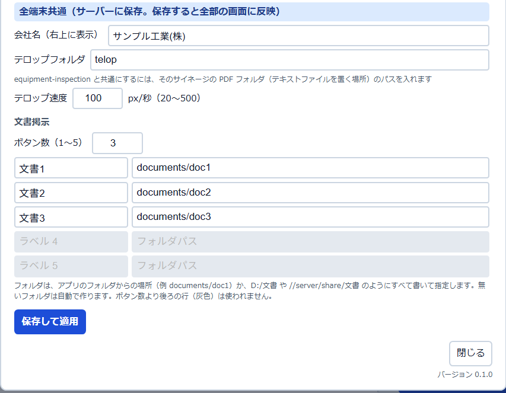

# デジタル掲示板 取扱説明書

バージョン 0.1.0

工場などの「本日の作業内容」ホワイトボードの代わりに、大型のタッチモニタ（と社内LANのほかのPC）で、本日の作業予定・連絡事項・今週の休日出勤予定・災害事例・文書を映すアプリです。
この説明書は、**アプリを自分の職場に入れる担当の方と、毎日の入力をする方**に向けて書いています。入れ方、毎日の使い方、自分の職場の会社名や作業内容への置き換え、困ったときの対処までを順に説明します。

> **ご利用の前に（免責事項）**
> このアプリは「現状有姿」で提供し、作者はいかなる保証もしません。使ったことで生じた損害について、作者は責任を負いません。法令にもとづく記録や、安全にかかわる判断に、このアプリだけを用いないでください（作業予定や災害事例の表示は、確認のための補助です）。画面にある会社名・人名・電話番号・工事名などのサンプルは、すべて架空のものです。

> **この説明書の画面写真について**
> 写真に写っている「サンプル工業(株)」や、人名・電話番号・工事件名は、すべて架空のサンプルです。アプリに付いているサンプルの内容を入れて、パソコンのブラウザ（Microsoft Edge）で撮影しました。写真の日付・時刻は、撮影した日のものです。

> **この説明書で確かめていないこと**
> 写真は、普通のパソコンの画面（1920×1080）で撮りました。**タッチ操作（指での拡大・スワイプ）、70インチのタッチモニタでの見え方、Windows のタッチキーボードが出るか、PC の起動と同時の自動起動は、実機では確かめていません。** 該当する場所に「未確認」と書いてあります。実際のモニタで試して、おかしいときは作者へ教えてください。

## 目次

1. [このアプリでできること](#1-このアプリでできること)
2. [用意するもの](#2-用意するもの)
3. [入れ方と起動](#3-入れ方と起動)
4. [画面の見かた](#4-画面の見かた)
5. [毎日の使い方](#5-毎日の使い方)
6. [設定（歯車）](#6-設定歯車)
7. [登録リストを自分の職場に合わせる](#7-登録リストを自分の職場に合わせる)
8. [災害事例PDFの入れ方](#8-災害事例pdfの入れ方)
9. [テロップ（画面の下に流れる文字）](#9-テロップ画面の下に流れる文字)
10. [config.json の項目](#10-configjson-の項目)
11. [他のPCから使う](#11-他のpcから使う)
12. [バックアップと引っ越し・新しい版への入れ替え](#12-バックアップと引っ越し新しい版への入れ替え)
13. [困ったとき](#13-困ったとき)
14. [付録：用語集](#付録用語集)

---

## 1. このアプリでできること

アプリは、1台のWindows PC（サーバーPC）で動かします。工場のモニタと、社内LANのほかのPCは、ブラウザ（Edge など）でサーバーPCのアドレスを開くだけで同じ画面を見られます。画面は3秒ごとに自動で更新されるので、どこで入力しても、数秒でみんなの画面に反映されます。ログイン（パスワード）はありません。


*メイン画面（明るい配色）。*

| 場所 | 名前 | できること |
|---|---|---|
| 左上 | 日付と題名 | 今日の日付（曜日つき）。右上には歯車ボタンと会社名 |
| 左の上段 | 連絡事項 | 自由な文章を3行以上書ける。赤字にもできる |
| 左の下段 | 本日の作業予定 | 工事件名・所属・責任者・作業内容・就業時間の一覧。前日の内容を引き継いで始まる |
| 右の上段 | 災害事例 | 選んだ作業ジャンルの災害事例PDFが、順番に自動で映る |
| 右の中段 | 作業ジャンル | 今日の作業にチェックを付けると、その災害事例が映る |
| 右の下段 | 今週の休日出勤予定 | 今週の土日祝・会社の休日に出勤する人と作業の一覧 |
| 右下 | 文書ボタン | 手順書などのPDFを開く（最大5つ） |
| 画面の一番下 | お知らせ（テロップ） | テキストファイルに書いた文章が、右から左へ流れる |

#### 特徴

- サーバーにするPCは1台だけです。ほかのPCやタブレットには何も入れず、ブラウザで開くだけで使えます。
- 入力は、あらかじめ登録した候補から大きなボタンで選ぶ形です。キーボードがなくても、指で入力できます（連絡事項だけは文字を打ちます）。
- データはすべてサーバーPCの中のファイルに保存します。インターネット上には送りません。
- 夜間（初めの設定では 18:00〜翌 7:30）は、時計だけの待機画面になります。

---

## 2. 用意するもの

| もの | 内容 |
|---|---|
| サーバーにするPC | Windows 10 または 11。掲示板を使う時間帯は電源を入れたままにします |
| Python | 3.10 以降。入れ方は次の章で説明します |
| ブラウザ | Microsoft Edge（Windows に最初から入っています）。この説明書は Edge で確かめています。ほかのブラウザは未確認です |
| インターネット | 最初のセットアップのときだけ必要です。動かし始めたあとは要りません |
| モニタ | 工場に置く大型モニタ（タッチ式でなくても、マウスで使えます） |

---

## 3. 入れ方と起動

### 3-1. Python を入れる（初めてのときだけ）

1. Python の公式サイト（https://www.python.org/ ）から、Windows 用のインストーラーをダウンロードします。
2. インストーラーを開き、最初の画面の下にある **「Add python.exe to PATH」に必ずチェックを入れて** から「Install Now」を押します。

> **注意**
> 「Add python.exe to PATH」のチェックを忘れると、次の「初回セットアップ.bat」が「Python が見つかりません」と表示して止まります。そのときは Python をもう一度インストールし直して、チェックを入れてください。

### 3-2. アプリを取ってくる

1. GitHub のこのアプリのページ（https://github.com/Nagasaki-Software/digital-bulletin-board ）を開き、右側の「Releases」の下にある、いちばん新しい版（例：「v0.1.0」）を押します。
2. 開いたページの下のほうにある「Assets」から、`digital-bulletin-board-v0.1.0.zip` のような **版数の付いた ZIP** を押してダウンロードします。
3. ダウンロードした ZIP を右クリック →「プロパティ」を開きます。下のほうに「セキュリティ：このファイルは他のコンピューターから取得したものです…」と出ていたら、**「許可する」にチェックを入れて「OK」** を押します。
4. ZIP を右クリック →「すべて展開」で展開します。できたフォルダがアプリのフォルダです。分かりやすい場所へ移し、名前を変えてかまいません。この説明書では `C:\digital-bulletin-board` に置いた前提で書きます。

> **「Source code (zip)」は選ばないでください**
> 同じ「Assets」に並ぶ「Source code (zip)」「Source code (tar.gz)」は、GitHub が自動で付けるものです。開発用のファイルまで入っていて、利用者向けではありません。緑色の「Code」ボタン →「Download ZIP」も同じです。

> **3 の「許可する」について**
> インターネットから取ったファイルには、Windows が「外から来たファイル」という印を付けます。そのまま展開すると、中の `.bat` を開いたときに「Windows によって PC が保護されました」などの警告が出て、止められることがあります。展開する前に「許可する」にしておけば、この警告は出ません。展開したあとで警告が出たときは、「詳細情報」→「実行」で進めます。

> **ヒント**
> OneDrive と同期しているフォルダ（デスクトップなど）は、同期の都合でデータのファイルが一時的に開けなくなることがあるため、避けたほうが安心です。`C:\` の直下のようなフォルダをおすすめします。

### 3-3. 初回セットアップ（初めてのときだけ）

1. アプリのフォルダにある **`初回セットアップ.bat`** をダブルクリックします。
2. 黒い窓が開き、必要な部品を自動でダウンロードします（数分かかります）。
3. 「セットアップが完了しました。」と出たら、何かキーを押して窓を閉じます。

> **「部品のインストールに失敗しました」と出たとき**
> 初回セットアップは、インターネットから部品（Flask・waitress・jpholiday など）をダウンロードします。インターネットにつながるか確かめてください。会社のネットワークが外部への接続を制限している（プロキシなど）と失敗します。つながっているのに失敗するときは、社内の情報システムの担当者に「Python の pip で、pypi.org からダウンロードできるようにしてほしい」と相談してください。

### 3-4. 起動する（毎回）

1. **`起動.bat`** をダブルクリックします。
2. 黒い窓が開きます。掲示板が動き出すのを待って（最大60秒）、いつもの Edge の画面で掲示板が開きます。

> **大切**
> 黒い窓が、アプリの本体です。**使っているあいだは閉じないでください。** 閉じると掲示板が止まり、どの画面も開けなくなります。最小化しておくのはかまいません。
> Edge の画面を閉じても掲示板は止まりません。もう一度開くときは、ブラウザで `http://localhost:5100` を開きます。

黒い窓には、「他のPCで開く」というアドレスも出ます（[11章](#11-他のpcから使う) で使います）。

**全画面にする**：モニタに映すときは、Edge で `F11` キーを押します。ブラウザの枠が消えて全画面になります。もう一度 `F11` で元に戻ります。

**終わるとき**

1. Edge は、ふつうに画面右上の「×」で閉じます（全画面のときは、`F11` で戻してから）。
2. 黒い窓をクリックしてから `Ctrl` キーを押しながら `C` キーを押します。掲示板が止まります。そのあとは窓を閉じてかまいません。

入力した内容は、止めても消えません。次に起動したときに続きから表示されます。

### 3-5. PCの電源を入れたら自動で起動させる

モニタ用のPCなど、毎朝だれかが `起動.bat` を押すのが難しいときは、Windows にサインインしたときに自動で起動するようにできます。

1. `起動.bat` を右クリック →「その他のオプションを確認」→「ショートカットの作成」を押します。
2. キーボードの `Windows` キーを押しながら `R` キーを押し、出てきた欄に `shell:startup` と入力して Enter を押します。「スタートアップ」フォルダが開きます。
3. 1 で作ったショートカットを、このフォルダへ移します。

> **未確認**
> この方法は、実機で確かめていません。設定したあとは、必ず PC を再起動して、掲示板が開くことを確かめてください。また、Windows にサインインしたあとに始まる方法なので、サインイン前から動かしたい場合は別の方法（タスクスケジューラなど）が必要です。

> **PCがスリープしないようにする**
> PCがスリープすると、掲示板も止まり、ほかのPCから開けなくなります。サーバーにするPCは、「設定」→「システム」→「電源」（ノートPCでは「電源とバッテリー」）→「画面とスリープ」で、スリープを「なし」にしてください。画面だけ消えるのはかまいません。

### 3-6. 初めて起動したときの Windows の確認

初めて起動したとき、Windows が「ファイアウォールでアクセスを許可しますか？」と聞くことがあります。ほかのPCからも使うときは、「プライベート ネットワーク」にチェックを入れて「アクセスを許可する」を押します。許可しないと、ほかのPCから開けません（サーバーPC自身では開けます）。くわしくは [11章](#11-他のpcから使う) を見てください。

---

## 4. 画面の見かた

### 4-1. 編集ボタンがあるときと、ないとき

画面には、2つの見え方があります。どちらにするかは、右上の歯車ボタン →「編集ボタン」で、**パソコンごとに** 選びます（[6章](#6-設定歯車)）。

| 見え方 | どんなとき | 特徴 |
|---|---|---|
| 編集ボタン「なし」（初めの設定） | 触った人がすぐ入力できる | 「＋ 行を追加」や ▲▼✕ が、いつも出ている |
| 編集ボタン「あり」 | 工場のモニタなど、誤って触れるおそれがある画面 | 普段は見るだけ。「編集」を押したときだけ入力できる |


*編集ボタン「あり」の、普段の画面。入力用のボタンが隠れて、一覧が広く見えます。右上に「編集」ボタンが出ています。*

### 4-2. 配色（明るい・暗い）

歯車ボタンから、「明るい」と「暗い」を選べます。これも、パソコンごとの設定です。


*暗い配色。明るい工場では「明るい」、暗めの場所では「暗い」が見やすいことがあります。*

### 4-3. 待機画面

夜間（初めの設定では 18:00〜翌 7:30）は、時計と日付だけの待機画面になります。画面のどこかに触れる（クリックする）と、掲示板に戻ります。戻したあと、5分間なにも触れないと、まだ夜間なら、また待機画面になります。待機画面になるときは、開いていた文書と設定の窓は閉じ、災害事例の自動再生は止まります。


*待機画面。（撮影用に、時間帯に関係なく待機画面を表示して撮りました。）*

時間帯は、`config.json` の `standby` で変えられます（[10章](#10-configjson-の項目)）。

### 4-4. 黄色の警告

画面の上に黄色い帯が出ることがあります。登録リストや `config.json` に問題があるときの知らせです。

| 出る文章の例 | 意味 |
|---|---|
| `config.json の accident_seconds が正しくありません（15秒を使います）` | `config.json` の書き間違い。その項目だけ、初めの値で動いています |
| `constructions.csv が見つかりません` | `data` フォルダに必要な CSV がありません |
| `companies.csv を読めません。Excelで『CSV UTF-8（コンマ区切り）』として保存し直してください` | CSV の保存形式が違います |
| `サーバーに接続できません。再接続しています…` | 黒い窓が閉じたか、ネットワークが切れています。つながり直すと自動で消えます |

直し方は [13章](#13-困ったとき) にあります。

---

## 5. 毎日の使い方

### 5-1. 入力の基本

**入力したい欄を指で押します（マウスならクリックします）。** 候補が並んだ大きなボタンの窓が開くので、選ぶ欄の候補を押すと、保存されて窓が閉じます。保存のためのボタンはありません。

- 窓の「クリア」は、その欄を空にします。
- 窓の「閉じる」は、何も変えずに閉じます。
- 保存に失敗すると、画面の下に赤い知らせが数秒出ます。

> **編集ボタン「あり」の画面で、押しても何も起きないとき**
> 右上の「編集」を押して、入力できる状態にしてください（[5-7](#5-7-編集ボタンの使い方)）。

### 5-2. 連絡事項


*連絡事項の行を押したところ。*

1. 連絡事項の行を押します。「連絡事項 1行目」のような窓が開きます。
2. 文章を入力します。
3. 目立たせたいときは「赤字で表示する」にチェックを入れます（赤い文字と、行頭の三角マークが付きます）。
4. 「決定」を押します（キーボードなら Enter でも決定できます）。やめるときは「キャンセル」です。

- 連絡事項は、いつも3行分の高さで表示されます。3行より多いときは、枠の中をスクロールします。
- 行を増やすには、編集中に出る「＋ 連絡事項を追加」を押します。増やした行は、4行以上あるときだけ「✕」で消せます（3行より少なくはできません）。
- 連絡事項は、**日ごとに空の3行から始まります。** 前の日の連絡事項は引き継がれません。

> **注意：文字を打つときのキーボード**
> 連絡事項は、文字を打つ唯一の入力です。タッチモニタで Windows のタッチキーボードが自動で出るかは、**実機では確かめていません（未確認）。** 出ないときは、タスクバーのタッチキーボードのボタンを使うか、キーボードをつないでください（[13章](#13-困ったとき)）。

### 5-3. 本日の作業予定

「＋ 行を追加」で空の行を足し、行の各欄を押して選びます。


*「作業内容」の欄を押したところ。いまの値（組み立て作業）が青く出ています。*

| 欄 | 選び方 |
|---|---|
| 工事件名 | 登録した工事件名から選ぶ |
| 所属・会社名 | 登録した会社名から選ぶ |
| 責任者 | **先に所属・会社名を選びます。** その会社の責任者だけが候補に出ます。選ぶと、名前の下に「内線 1234」「外線 03-…」が自動で出ます |
| 作業内容 | 登録した作業内容から選ぶ |
| 就業予定 | 開始時刻を選び、続けて終了時刻を選ぶ |


*就業予定の欄を押したところ。まず「開始時刻」、次に「終了時刻」の窓が出ます。窓は下へスクロールできます。*

- 開始時刻で「クリア」を押すと、開始・終了の両方が空になります。
- 所属・会社名を別の会社に変えると、責任者は空に戻ります（会社ごとに責任者が違うため）。
- 行の右にある **▲▼** で行の順番を入れ替えます。**✕** で行を消します（「この行を削除しますか？」と確認が出ます）。消すと、下の行が上に詰まります。


*✕を押したときの確認。「やめる」で戻れます。*

- **前の日の内容が引き継がれます。** 日付が変わって最初に画面を開くと、いちばん最近に入力のあった日の行が、そのまま今日の行になります。変わるところだけ直してください。
- 一覧は、行が少ないときも空白の行を含めて7行分の高さで表示します。多いときは、枠の中をスクロールします。

### 5-4. 今週の休日出勤予定

月曜〜日曜の1週間のうち、土曜・日曜・祝日・会社の休日に出勤する人を入れる一覧です。

1. 編集中に出る「＋ 行を追加」を押します。
2. 今週の休日の日付だけが並んだ窓が出るので、日付を選びます。

   

   *日付の窓。今週の休日（この例では土曜と日曜）だけが出ます。祝日や会社の休日には、名前が付きます（例：「12/29(火・年末休業)」）。*

3. 行ができたら、工事件名・氏名・会社名・作業内容・就業予定の各欄を、作業予定と同じように選びます。「氏名・会社名」の候補は、`companies.csv` の内容です。
4. 日付を変えたいときは、日付の欄を押して選び直します。行を消すときは「✕」です。

- 一覧は、**週ごとに** 切り替わります。月曜になると、先週の行は見えなくなり、空欄から始まります。
- 土曜は青、日曜・祝日・会社の休日は赤で出ます。
- 今週に休日がないときは「今週は休日がありません。会社の休日は data/custom_holidays.csv に登録します。」と出ます（[7章](#7-登録リストを自分の職場に合わせる)）。
- 祝日は自動で判別します。会社だけの休日（創立記念日・年末休業など）は、`custom_holidays.csv` に登録します。

### 5-5. 作業ジャンルと災害事例


*災害事例の枠と、作業ジャンル。枠の左上にジャンル名、右下に「何件目／全部で何件」、下に次へ進むまでの進み具合が出ます。*

1. 「作業ジャンル」の中から、今日の作業に当てはまるものを押してチェックを入れます（もう一度押すと外れます）。
2. チェックしたジャンルの災害事例PDFが、決まった秒数（初めの設定は15秒）ごとに、順番に映ります。PDFが複数ページのときは、1ページずつ映ります。
3. 手でめくるには、枠の **右半分を押す** と次へ、**左半分を押す** と前へ戻ります。左右にスワイプしても、めくれます（指のなぞり方（スワイプ）の操作感は、実機では未確認です）。

- ジャンルのチェックも、**前の日の内容が引き継がれます。**
- 枠の中には、状況に応じて次の文章が出ます。

| 出る文章 | 意味 |
|---|---|
| 作業ジャンルを選ぶと災害事例が表示されます | まだジャンルにチェックが付いていません |
| 該当する災害事例がありません | チェックしたジャンルのPDFが、`accident_cases` フォルダにありません（[8章](#8-災害事例pdfの入れ方)） |
| この資料は表示できません | そのPDFが壊れているなどで開けません。数秒で次の資料へ進みます |

### 5-6. 文書を見る

右下の文書ボタン（初めの設定では「文書1」「文書2」「文書3」）を押すと、そのフォルダにあるPDFの一覧が出ます。


*文書ボタンを押したところ。一覧の名前は、ファイル名から「.pdf」を除いたものです。*

一覧の名前を押すと、PDFが開きます。


*文書の表示。左上の「◀」「▶」でページをめくり、「－」「＋」で縮小・拡大します。*

- 「一覧へ」で一覧に戻り、「閉じる」で掲示板に戻ります。
- 拡大は、指を広げる操作（ピンチ）か、`Ctrl` キーを押しながらマウスのホイールを回す方法でもできます（ピンチの操作感は、実機では未確認です）。
- **2分間なにも操作しないと、自動で掲示板に戻ります。**（`documents.idle_return_seconds` で変えられます）
- 文書ボタンの名前・数・フォルダは、歯車の設定で変えます（[6章](#6-設定歯車)）。PDFは、対応するフォルダに入れるだけで一覧に出ます。

### 5-7. 編集ボタンの使い方

編集ボタン「あり」の画面（[4-1](#4-1-編集ボタンがあるときとないとき)）では、次のように使います。


*「編集」を押したあとの画面。ボタンが「完了」に変わり、「＋ 行を追加」や ▲▼✕ が出ています。*

1. 右上の「編集」を押します。入力用のボタンが出て、入力できる状態になります。
2. 必要な入力をします。
3. 終わったら「完了」を押します。見るだけの画面に戻ります。

押し忘れても、**60秒間なにも触れないと、自動で見るだけの画面に戻ります。** 触れるたびに、この60秒は数え直されます（`edit_lock_seconds` で変えられます）。

> **ヒント**
> 編集ボタンは、うっかり触れて入力が変わるのを防ぐためのものです。暗証番号はありません。歯車の設定で「なし」に戻せば、だれでも入力できます。

---

## 6. 設定（歯車）

画面の右上の歯車ボタンを押すと、設定の窓が開きます。設定は2つに分かれています。窓のいちばん下には、アプリの **バージョン**（例：0.1.0）が出ます。

### 6-1. この端末だけ


*設定の上半分。このパソコンのブラウザだけに保存されます。*

| 項目 | 内容 |
|---|---|
| 編集ボタン | 「あり」：普段は見るだけで、「編集」を押すと入力できる。「なし」：いつも入力できる（初めの設定） |
| 配色 | 「明るい」または「暗い」 |

- 選んだ内容は、**そのパソコンの Edge に保存** されます。工場のモニタで選んでも、ほかのPCの設定は変わりません。
- ブラウザの閲覧データを消すと、選んだ内容は初めの設定に戻ります。モニタのPCでは、`config.json` に `default_edit_button` と `default_theme` を書いておくと、保存がないときも決めた状態で始まります（[10章](#10-configjson-の項目)）。
- 同じPCでも、`http://localhost:5100` と `http://（IPアドレス）:5100` のように **開くアドレスが違うと、別のパソコン扱い** になり、設定が別々に保存されます。

> **未確認**
> `起動.bat` で開く普通の Edge で、選んだ設定が再起動後も残るかは、実機で確かめていません。残らないときは、上の `config.json` の方法にしてください。

### 6-2. 全端末共通



*設定の下半分。サーバーPCの `config.json` に保存され、全部の画面に反映されます。*

| 項目 | 内容 |
|---|---|
| 会社名（右上に表示） | 画面の右上に出る会社名。1〜100文字 |
| テロップフォルダ | お知らせの `.txt` を置くフォルダ。空欄なら、アプリのフォルダの中の `telop`（[9章](#9-テロップ画面の下に流れる文字)） |
| テロップ速度 | 下に流れる文字の速さ（20〜500、初めは100） |
| 文書掲示 ボタン数 | 文書ボタンの数（1〜5） |
| ラベル 1〜5・フォルダパス | 各ボタンの名前と、PDFを入れるフォルダ |

- 変えたら、**「保存して適用」** を押します。掲示板を止めて起動し直さなくても、数秒で全部の画面に反映されます。
- ボタン数より後ろの行は灰色になって使われません（入力した文字は残り、ボタン数を増やすとまた使えます）。使う行は、ラベルとフォルダパスの両方が必要です。
- フォルダパスは、アプリのフォルダからの場所（例：`documents/doc1`）か、`D:/文書`・`//server/share/文書` のようにすべて書いた場所を指定します。**無いフォルダは自動で作ります**（作れない場所のときは、保存はされ、「作れませんでした」と知らせが出ます）。`..` は使えません。
- 間違いがあるときは、窓の下に赤字で「⚠ ラベル 2 を入力してください」のように出て、何も保存されません。
- 保存すると、`config.json` のうち、上の項目だけが書き換わります。手で書いたほかの項目は、そのまま残ります。

> **注意（セキュリティ）**
> この掲示板にはログインがないため、社内LANにつながった **どの端末からでも** 「全端末共通」の設定を変えられます。LANに知らない人がつながる環境では使わないでください。ネットワークの場所（`\\サーバー名\…`）を指定すると、サーバーPCがそこへ接続しに行きます。社内の信頼できる場所だけを指定してください。

---

## 7. 登録リストを自分の職場に合わせる

画面で選べる会社名・責任者・作業内容などの候補は、アプリのフォルダの `data` フォルダにある **CSV ファイル** に入っています。Excel で開いて直せます。**保存すると、掲示板の画面は数秒で自動で反映されます**（掲示板を止める必要はありません）。

アプリに付いている中身は、架空のサンプル（サンプル工業(株) など）です。自分の職場の内容に書き換えてください。

### 7-1. Excel で直すときの注意

> **保存の形式**
> 「名前を付けて保存」で、ファイルの種類を **「CSV UTF-8（コンマ区切り）」** にしてください。ふつうの「CSV（コンマ区切り）」で保存すると、日本語が読めなくなり、画面の上に黄色い警告が出ます。
> 1行目（`name` や `company,leader_name,ext,outside` などの見出し）は、**消したり書き換えたりしないでください。**

- 空の行は無視されます。

### 7-2. ファイルごとの中身

| ファイル | 列 | 内容 |
|---|---|---|
| `companies.csv` | `name` | 所属・会社名（休日出勤の「氏名・会社名」にも使います） |
| `leaders.csv` | `company,leader_name,ext,outside` | 責任者。会社名ごとに登録します |
| `works.csv` | `name` | 作業内容 |
| `constructions.csv` | `name` | 工事件名（作業予定のいちばん左と、休日出勤の「日付」の右の欄） |
| `genres.csv` | `name` | 作業ジャンル（並びの順もこの順） |
| `times.csv` | `time` | 就業予定の時刻の候補 |
| `custom_holidays.csv` | `date,name` | 会社の休日 |

#### companies.csv・works.csv・constructions.csv

1列だけのファイルです。1行に1つ書きます。

```
name
1班
2班
見本電機
```

#### leaders.csv（責任者）

| 列 | 内容 | 例 |
|---|---|---|
| `company` | 所属・会社名 | 見本電機 |
| `leader_name` | 責任者の名前 | 田中 |
| `ext` | 内線番号（空でもよい） | 1234 |
| `outside` | 外線番号（空でもよい） | 03-0000-0001 |

```
company,leader_name,ext,outside
1班,佐藤,1234,
見本電機,田中,,03-0000-0001
```

- `company` は、`companies.csv` にある会社名と **同じ文字** にしてください。違うと、その会社の責任者の候補に出ません。
- 内線と外線は、どちらか一方だけでもかまいません。両方あるときは「内線 2345 / 外線 03-0000-0002」のように出ます。

#### genres.csv（作業ジャンル）

1行に1つ書きます。画面のジャンルのボタンは、ここに書いた順に並びます。

> **注意：ジャンル名を変えるとき**
> ジャンルの名前を変えたら、`accident_cases` フォルダの災害事例PDFのファイル名の先頭も、同じ名前に直してください（[8章](#8-災害事例pdfの入れ方)）。直さないと、そのPDFは映りません。また、`genres.csv` から消したジャンルのチェックは、画面に出なくなります。

#### times.csv（就業予定の時刻）

見出しは `time`、1行に1つ、`8:00`・`8:30` のように書きます。**このファイルが無いと、6:00〜22:00 の30分きざみで自動で作られます。** 15分きざみにしたいときなどに書き換えます。

#### custom_holidays.csv（会社の休日）

祝日は自動で判別されるので、**会社独自の休日だけ** を書きます。

| 列 | 内容 | 例 |
|---|---|---|
| `date` | 日付（年-月-日） | 2026-12-29 |
| `name` | 休日の名前 | 年末休業 |

```
date,name
2026-12-29,年末休業
```

日付は `2026-12-29` のほか、`2026/12/29`・`2026-1-5` の形も読めます。形が違う行は無視され、画面の上に「custom_holidays.csv の日付が正しくありません」と出ます。このファイルは無くてもかまいません。

### 7-3. 間違えたとき

| 間違い | どうなるか |
|---|---|
| ファイルが無い（`times.csv` と `custom_holidays.csv` 以外） | 黄色の警告「○○.csv が見つかりません」が出る。その候補は選べない |
| 保存の形式が違う（文字化け） | 黄色の警告「○○.csv を読めません。Excelで『CSV UTF-8…』として保存し直してください」が出る。その候補は選べない |
| 1行目の見出しを消した・書き換えた | 黄色の警告「○○.csv に列がありません」が出る |
| 候補から消した会社名・作業内容 | すでに画面に入っている行の表示は、そのまま残る。新しくは選べなくなる |
| `leaders.csv` から消した責任者 | 画面の名前は残るが、内線・外線の番号は出なくなる |

### 7-4. 使い始める前のチェックリスト

本番で使い始める前に、上から順に確かめてください。

| | 確かめること | 参照 |
|---|---|---|
| □ | `companies.csv` に、自分の職場の会社名・班の名前を入れた | [7-2](#7-2-ファイルごとの中身) |
| □ | `leaders.csv` に、責任者と内線・外線を入れた | [7-2](#7-2-ファイルごとの中身) |
| □ | `works.csv`・`constructions.csv`・`genres.csv` を自分の職場の内容にした | [7-2](#7-2-ファイルごとの中身) |
| □ | `custom_holidays.csv` に、会社独自の休日を入れた（祝日は不要） | [7-2](#7-2-ファイルごとの中身) |
| □ | 歯車の設定で、会社名を入れた | [6章](#6-設定歯車) |
| □ | 災害事例のPDFを入れ、ジャンルのチェックで映ることを確かめた | [8章](#8-災害事例pdfの入れ方) |
| □ | 文書ボタンの名前とフォルダを決め、PDFを入れた | [6章](#6-設定歯車) |
| □ | お知らせの文章を `telop` フォルダに入れた | [9章](#9-テロップ画面の下に流れる文字) |
| □ | 工場のモニタで、編集ボタンの「あり」「なし」と配色を選んだ | [4章](#4-画面の見かた) |
| □ | ほかのPCから開けることを確かめた（使う場合） | [11章](#11-他のpcから使う) |
| □ | PCがスリープしない設定にし、必要なら自動起動を設定した | [3-5](#3-5-pcの電源を入れたら自動で起動させる) |
| □ | バックアップの方法（どこへ、いつコピーするか）を決めた | [12章](#12-バックアップと引っ越し新しい版への入れ替え) |

---

## 8. 災害事例PDFの入れ方

災害事例のPDFは、アプリのフォルダの **`accident_cases`** フォルダに入れます（無ければ、起動したときに自動で作られます）。フォルダの場所を変えたいときは、`config.json` の `accident_folder` を書き換えます（[10章](#10-configjson-の項目)）。

### 8-1. ファイル名の決まり

**ファイル名の先頭が作業ジャンル名** です。次の形にします。

```
ジャンル名_内容.pdf
```

| 例 | 意味 |
|---|---|
| `溶接作業_事例A.pdf` | 「溶接作業」にチェックが付いたときに映る |
| `溶接作業＋高所作業_事例B.pdf` | 「溶接作業」か「高所作業」のどちらかにチェックが付いたときに映る（1回だけ映ります。重ねては映りません） |

- ジャンル名と内容は、半角のアンダーバー（`_`）で区切ります。
- 複数のジャンルに当てはまる事例は、ジャンル名を `＋`（全角でも半角でも可）でつなぎます。
- **`genres.csv` にない名前のファイルは映りません。** ジャンル名は、`genres.csv` と同じ文字にしてください。
- 並びの順は、`genres.csv` のジャンルの順です。同じジャンルのなかは、ファイル名の順です。

### 8-2. PDFの作り方

- 複数ページのPDFは、1ページずつ順に映ります。
- **横向きのA4** で作ると、枠にぴったり収まります。縦向きや別の大きさでも映りますが、余白が出ます。
- PDFを入れたり差し替えたりすると、数秒で反映されます（掲示板を止める必要はありません）。

---

## 9. テロップ（画面の下に流れる文字）

画面の一番下に、「お知らせ」の文字が右から左へ流れます。文章は、**テキストファイル** に書きます。Excel は要りません。メモ帳で書いて、拡張子を `.txt` にして保存するだけです。


*画面の一番下。左の「お知らせ」の札の右に、文章が流れます。オレンジの丸い札（バッジ）は、文章の一部を `"` で囲んだものです。*

### 9-1. 書き方

アプリのフォルダの `telop` フォルダ（無ければ起動時に自動で作られます）に、`.txt` ファイルを置きます。

```
"重要"本日15時から避難訓練を行います。集合場所は第1駐車場です
"連絡"12月29日から年末休業です
ご安全に。指差呼称を忘れずに
```

- フォルダの中の `.txt` を、**ファイル名の順** にすべて読みます。ファイルはいくつ置いてもかまいません。
- **1行が1件のお知らせ** です。空の行は無視されます。件と件のあいだは、広くあけて流れます。
- 文章の一部を `"` で囲むと、そこだけオレンジ色の丸い札（バッジ）になります。全角の `＂` や、カーブした `“` `”` も使えます。閉じ忘れなど、対になっていない引用符は、ふつうの文字のまま出ます。
- 文字コードは、メモ帳の標準の UTF-8 でも、Shift-JIS（ANSI）でも、UTF-16（メモ帳の「Unicode」）でも読めます。
- 流す件数は全部で200件までです。1件は500文字までで、超えた分は切れます。**1MB を超える大きなファイルは読まれません。**
- ファイルを保存すると、数秒で画面に反映されます。
- お知らせが1件もないときは「お知らせはありません」と流れます。
- 待機画面・設定・文書の閲覧のときは、テロップは、その下に隠れます。

流れる速さ（テロップ速度）と、お知らせを置くフォルダは、歯車の設定「全端末共通」で変えます（[6章](#6-設定歯車)）。

### 9-2. 設備点検システム（equipment-inspection）と同じお知らせを使う

同じ作者の姉妹アプリ「設備点検システム（equipment-inspection）」のサイネージも、フォルダの中の `.txt` を1行1件で読みます（形式は上と同じです）。**同じフォルダを指定すれば、2つのアプリで同じお知らせが流れます。**

1. 設備点検システムのサイネージで、お知らせの `.txt` を置いているフォルダ（PDF フォルダ）の場所を調べます。
2. デジタル掲示板の歯車 →「全端末共通」→「テロップフォルダ」に、その場所を入れて「保存して適用」を押します。

> **注意**
> 2つのアプリが **同じファイルを読む** ので、片方のために直した行は、もう片方にも出ます。別々にしたいときは、フォルダを分けてください。デジタル掲示板が読むのは、そのフォルダの `.txt` だけです。PDF やほかの種類のファイルは無視されます。ネットワーク上のフォルダを指定するときは、信頼できる場所だけにしてください（[6章](#6-設定歯車) の注意）。

---

## 10. config.json の項目

`config.json` は、アプリのフォルダに置く設定ファイルです。**無くても、初めの設定で動きます。** 変えたい項目があるときだけ書きます。歯車の設定で「保存して適用」を押すと、このファイルは自動で作られ（または書き換えられ）ます。

メモ帳で開いて直します。保存のときは、文字コードを **「UTF-8」** にしてください。直したら、掲示板を止めてもう一度起動します（歯車の設定から保存した項目だけは、起動し直さなくても反映されます）。

例（会社名と、災害事例の表示秒数だけ変える）：

```
{
  "company_name": "株式会社〇〇",
  "accident_seconds": 20
}
```

| 項目 | 初めの値 | 内容 |
|---|---|---|
| `company_name` | サンプル工業(株) | 画面右上の会社名（1〜100文字）。歯車の設定でも変えられます |
| `default_edit_button` | off | 編集ボタンの初めの状態（`on` か `off`）。そのパソコンで歯車から選んだ値があれば、そちらが優先されます |
| `default_theme` | light | 配色の初めの状態（`light` か `dark`）。そのパソコンで選んだ値があれば、そちらが優先されます |
| `accident_folder` | accident_cases | 災害事例PDFのフォルダ |
| `accident_seconds` | 15 | 災害事例1枚（1ページ）を映す秒数 |
| `documents.buttons` | 文書1〜3 | 文書ボタン（最大5つ。ボタンごとに `label` と `folder` を書く）。歯車の設定でも変えられます |
| `documents.idle_return_seconds` | 120 | 文書を見ていて、操作がないときに掲示板へ戻る秒数 |
| `telop.speed` | 100 | お知らせの流れる速さ（20〜500の整数）。歯車の設定でも変えられます |
| `telop.folder` | telop | お知らせの `.txt` を置くフォルダ |
| `edit_lock_seconds` | 60 | 「編集」で入力中、操作がないときに見るだけに戻る秒数 |
| `standby.start` / `standby.end` | 18:00 / 07:30 | 待機画面にする時間帯（`18:00` の形で書く） |
| `standby.wake_idle_seconds` | 300 | 待機画面から戻したあと、操作がないときに待機に戻る秒数 |

- **フォルダの場所の書き方：** `/` で区切るか（例：`D:/掲示板/災害事例`）、`\\` のように2つ重ねます（例：`D:\\掲示板\\災害事例`）。`\` を1つだけ書くと、書き間違いになります。
- **秒数** は、1 以上 86400 以下の数字で書きます。
- **書き間違いがあるとき：** その項目だけ、初めの値を使って起動し、画面の上に黄色い警告が出ます（例：「config.json の accident_seconds が正しくありません（15秒を使います）」）。`config.json` を直して、掲示板を起動し直してください。
- 文書ボタンの `label` や会社名などの文字は100文字まで、フォルダの場所は260文字までです。
- フォルダが作れない場所（存在しないドライブなど）を指定したときも、起動は続き、警告が出ます。
- `config.json` 自体に書き間違い（カンマの欠けなど）があると、歯車の設定からは **保存できません**（手で書いた設定を消さないためです）。メモ帳で直してから、もう一度保存してください。

---

## 11. 他のPCから使う

社内LANのほかのPC（や、ブラウザの使えるタブレット）からも、同じ画面を見たり、入力したりできます。**特別な設定は要りません。** 掲示板は、ほかのPCからの接続を最初から受け付けます。

1. サーバーPCで `起動.bat` を起動します。
2. 黒い窓に出る「他のPCで開く： `http://（数字のアドレス）:5100`」を控えます。
3. ほかのPCのブラウザで、そのアドレスを入力して開きます。

黒い窓に出るアドレスが、つながらない（正しくない）ときは、サーバーPCで次の方法で調べます。

1. スタートメニューから「コマンドプロンプト」を開き、`ipconfig` と入力して Enter を押します。
2. 「IPv4 アドレス」の数字（例：`192.168.1.20`）を控えます。
3. ほかのPCで `http://（控えた数字）:5100` を開きます。

- **ポート番号は 5100 で固定です。** 変えることはできません。
- 開けないときは、サーバーPCのファイアウォールで **5100番（TCP）** の受け付けが許可されているか確かめてください。初めて起動したときの確認画面では、「プライベート ネットワーク」を許可します（[3-6](#3-6-初めて起動したときの-windows-の確認)）。
- ほかのPCで行った入力も、数秒で全部の画面に反映されます。同じ欄を同時に直すと、あとから保存したほうが残ります。
- ほかのPCの歯車の「この端末だけ」の設定（編集ボタン・配色）は、そのPCだけに保存されます。

> **大切**
> このアプリは、社内LANの中だけで使う前提で作られています。ログインはなく、LANにつながった端末なら、どれからでも入力でき、歯車の「全端末共通」の設定も変えられます。インターネットから見える場所には置かないでください。

---

## 12. バックアップと引っ越し・新しい版への入れ替え

### 12-1. バックアップするもの

次のフォルダとファイルを、定期的に別の場所（共有フォルダやUSBメモリなど）へコピーしてください。**確実に取るために、掲示板を止めてからコピーします**（黒い窓で `Ctrl` + `C`）。

| もの | 中身 |
|---|---|
| `data\board.db` | 掲示板に入力した内容（いちばん大切です） |
| `data\board.db-wal`・`data\board.db-shm` | 掲示板が動いているあいだだけある補助ファイル。あれば、一緒にコピーします |
| `data` の `*.csv` | 会社名・責任者・作業内容・工事件名・ジャンル・時刻・会社の休日 |
| `config.json` | 会社名・文書ボタン・各種の設定（無いときは、コピーするものはありません） |
| `accident_cases` | 災害事例のPDF |
| `documents` | 文書ボタンで見せるPDF |
| `telop` | お知らせの `.txt` |

文書・お知らせ・災害事例のフォルダを、別の場所（`D:/…` や共有フォルダ）に置いている場合は、そちらもバックアップしてください。

### 12-2. 新しいPCへ引っ越す

1. 新しいPCに、[3章](#3-入れ方と起動) のとおりアプリを入れ、`初回セットアップ.bat` まで済ませます。
2. 古いPCで掲示板を止めてから、上の表のフォルダとファイルを、新しいPCのアプリのフォルダへ上書きコピーします。
3. `起動.bat` で起動し、入力した内容や登録リストが引き継がれていることを確かめます。

> **注意**
> `.venv` フォルダはコピーしないでください。PCごとに `初回セットアップ.bat` で作り直すものです。

### 12-3. 新しい版に入れ替える

GitHub のこのアプリのページの「Releases」に新しい版が出たときは、**新しいフォルダに入れてから、入力した内容と設定を移す** 方法で入れ替えます。古いフォルダはしばらく残しておけるので、うまくいかなかったときにすぐ戻せます。

1. いまの版を、歯車の設定の窓の下（「バージョン 0.1.0」）で確かめておきます。
2. 掲示板を止めます（黒い窓で `Ctrl` + `C`）。
3. 新しい版の ZIP を [3-2](#3-2-アプリを取ってくる) と同じ手順で取り、**別の名前のフォルダ**（例：`C:\digital-bulletin-board-new`）に展開します。
4. 古いフォルダから新しいフォルダへ、次のものをコピーします（新しいフォルダに同じ名前のものがあるときは、上書きします）。

   | コピーするもの | 中身 |
   |---|---|
   | `data`（`board.db` と `*.csv`） | 入力した内容と、登録リスト |
   | `config.json` | 設定 |
   | `accident_cases` | 災害事例のPDF |
   | `documents` | 文書のPDF |
   | `telop` | お知らせ |

5. 新しいフォルダで `初回セットアップ.bat` を実行します（新しい版で部品が増えていることがあるため）。
6. 新しいフォルダの `起動.bat` で起動し、歯車の設定の窓の下のバージョンが新しくなったこと、入力した内容が残っていることを確かめます。
7. 問題がなければ、古いフォルダの名前を変えて（例：`digital-bulletin-board-old`）しばらく残し、新しいフォルダの名前を元の名前に変えます。フォルダの場所が元どおりになるので、自動起動のショートカットもそのまま使えます。

> **注意**
> 新しい版の `data` フォルダには、サンプルの CSV が入っています。4 で古いフォルダの `data` を上書きコピーするのを忘れると、登録リストがサンプルの内容に戻り、入力した内容も見えなくなります。
> 以前の版の `board.db` は、新しい版で起動したときに、必要な項目が自動で足されます（入力済みの内容は残ります）。

### 12-4. 使うのをやめるとき

アプリは、Windows の設定には何も書き込みません。使うのをやめるときは、必要なデータを別の場所にコピーしてから、アプリのフォルダごと消せば終わりです。自動起動を設定していた場合は、スタートアップフォルダのショートカットも消してください。Python が不要になったら、Windows の「設定」→「アプリ」から削除できます。

---

## 13. 困ったとき

| 困ったこと | 原因と対処 |
|---|---|
| 画面が真っ黒で、時計と日付だけ出ている | **待機画面** です。夜間（初めの設定では 18:00〜翌 7:30）は、時計だけになります。画面に触れると戻ります（[4-3](#4-3-待機画面)） |
| 画面が開かない・「このサイトにアクセスできません」と出る | 黒い窓（掲示板の本体）が閉じています。`起動.bat` で起動し直してください。ほかのPCからは、アドレスが合っているかも確かめてください |
| 黄色の帯に「サーバーに接続できません。再接続しています…」と出る | 黒い窓が止まったか、ネットワークが切れています。黒い窓が開いているか確かめてください。つながり直すと、自動で消えます |
| 黄色の帯に「○○.csv が見つかりません」などと出る | `data` フォルダの CSV に問題があります。[7章](#7-登録リストを自分の職場に合わせる) を見てください |
| 黄色の帯に「config.json の…が正しくありません」と出る | `config.json` の書き間違いです。[10章](#10-configjson-の項目) のとおり直して、掲示板を起動し直してください |
| `.bat` を開くと「Windows によって PC が保護されました」と出る | インターネットから取ったファイルに付く警告です。「詳細情報」→「実行」で進めます。次からは、ZIP を展開する前に「許可する」にしてください（[3-2](#3-2-アプリを取ってくる)） |
| `初回セットアップ.bat` で「Python が見つかりません」と出る | Python が入っていないか、「Add python.exe to PATH」にチェックが入っていません。[3-1](#3-1-python-を入れる初めてのときだけ) のとおり入れ直してください |
| `初回セットアップ.bat` で「部品のインストールに失敗しました」と出る | インターネットにつながっていないか、会社のネットワークが接続を制限しています（[3-3](#3-3-初回セットアップ初めてのときだけ) 参照） |
| `起動.bat` で「.venv が見つかりません」と出る | 先に `初回セットアップ.bat` を実行してください |
| `起動.bat` の黒い窓にエラーが出て、すぐ止まる | **掲示板がすでに動いている** ことが多いです（`起動.bat` を2回押した場合など）。もう1つの黒い窓があれば、それを使ってください。それでもなければ、ほかのアプリが 5100 番を使っています。ポートは変えられないので、そのアプリを止めてから起動し直してください（エラーの文言は、実機では未確認です） |
| 押しても何も起きない・入力できない | 編集ボタン「あり」の画面です。右上の「編集」を押してください（[5-7](#5-7-編集ボタンの使い方)） |
| 責任者の欄を押すと「先に所属・会社名を選んでください」と出る | 先に、同じ行の所属・会社名を選びます（[5-3](#5-3-本日の作業予定)） |
| 責任者の欄を押すと「この会社の責任者は登録されていません」と出る | `leaders.csv` に、その会社の責任者がありません。会社名の文字が、`companies.csv` と同じかも確かめてください |
| 工事件名が選べない（候補が出ない） | `constructions.csv` が無いか、中が空です（[7章](#7-登録リストを自分の職場に合わせる)） |
| CSV を直したら、文字化けした・黄色の警告が出た | Excel で「CSV UTF-8（コンマ区切り）」を選んで保存し直してください（[7-1](#7-1-excel-で直すときの注意)） |
| 休日出勤の日付に、出勤したい日が出ない | 日付の候補は、**今週（月曜〜日曜）の土日・祝日・会社の休日だけ** です。平日や、来週の休日は選べません。会社の休日は `custom_holidays.csv` に登録します。祝日は自動で判別しますが、新しく決まった祝日などが出ないときは、`custom_holidays.csv` に書いてください |
| 災害事例が出ない（「作業ジャンルを選ぶと…」と出る） | 作業ジャンルにチェックが付いていません（[5-5](#5-5-作業ジャンルと災害事例)） |
| 災害事例が出ない（「該当する災害事例がありません」と出る） | `accident_cases` に、そのジャンルのPDFがありません。ファイル名が `ジャンル名_内容.pdf` の形か、ジャンル名が `genres.csv` と同じ文字か、拡張子が `.pdf` か確かめてください（[8章](#8-災害事例pdfの入れ方)） |
| 災害事例に「この資料は表示できません」と出る | そのPDFが壊れているか、開けない形式です。別のPDFで試してください |
| 文書ボタンを押すと「文書がありません」と出る | そのボタンのフォルダに、PDFが入っていません。歯車の設定で、フォルダの場所を確かめてください |
| テロップが流れない・「お知らせはありません」と出る | `telop` フォルダ（または設定したフォルダ）に `.txt` があるか、1MB を超えていないか確かめてください。拡張子が `.txt.txt` になっていることもあります（[9章](#9-テロップ画面の下に流れる文字)） |
| 文字を入れる画面で、タッチキーボードが出ない | 実機では確かめていません（未確認）。タスクバーの右のほうにあるタッチキーボードのボタンを押すか、キーボードをつないでください。ボタンが見当たらないときは、タスクバーを右クリックして「タスクバーの設定」から、タッチキーボードを表示に切り替えられます |
| ほかのPCからつながらない | サーバーPCで掲示板が動いているか、アドレスが合っているか、ファイアウォールで 5100 番が許可されているかを確かめてください（[11章](#11-他のpcから使う)） |
| 設定の「保存して適用」で赤字の知らせが出る | 窓の下の文章のとおり、入力を直してください。「config.json に書き間違いがあります」と出たときは、`config.json` をメモ帳で直してから保存し直します（[10章](#10-configjson-の項目)） |
| 画面の内容が、ほかのPCと違って見える | 画面は3秒ごとに自動で更新されます。数秒待っても変わらないときは、ブラウザで `F5` キーを押して読み込み直してください |
| 歯車で選んだ編集ボタン・配色が、元に戻る | その設定は、そのパソコンの Edge に保存されています。ブラウザの閲覧データを消した場合などに戻ります。`config.json` の `default_edit_button` と `default_theme` に書いておくと、戻っても決めた状態になります |

---

## 付録：用語集

| ことば | 意味 |
|---|---|
| 掲示板 | このアプリのメインの画面。連絡事項・作業予定・休日出勤・災害事例などをまとめて映す |
| サーバーPC | 掲示板を動かしているPC。このPCの黒い窓を閉じると、掲示板が止まる |
| 黒い窓 | `起動.bat` を開くと出る窓。アプリの本体で、閉じると掲示板が止まります |
| 連絡事項 | 自由に書ける文章の欄。赤字にできる。日ごとに空の3行から始まる |
| 本日の作業予定 | 今日の作業の一覧。前の日の内容を引き継いで始まる |
| 休日出勤予定 | 今週の土日祝・会社の休日に出勤する人の一覧。週ごとに切り替わる |
| 作業ジャンル | 作業の種類（溶接作業・高所作業など）。チェックすると、そのジャンルの災害事例が映る |
| 災害事例 | 過去の事故の事例などをまとめたPDF。`accident_cases` フォルダに入れる |
| 文書ボタン | 右下のボタン。手順書などのPDFを開く（最大5つ） |
| テロップ（お知らせ） | 画面の一番下に、右から左へ流れる文字。`.txt` に書く |
| バッジ | テロップの中の、オレンジ色の丸い札。文章の一部を `"` で囲むと付く |
| 編集ボタン | 「あり」にすると、普段は見るだけで、「編集」を押したときだけ入力できる |
| 待機画面 | 夜間などに出る、時計だけの画面。触れると戻る |
| この端末だけ | 歯車の設定のうち、そのパソコンのブラウザにだけ保存される項目（編集ボタン・配色） |
| 全端末共通 | 歯車の設定のうち、サーバーPCの `config.json` に保存され、全部の画面に反映される項目 |
| CSV | 表のデータを入れた、文字のファイル。Excel で開いて直せる。`data` フォルダにある |
| config.json | アプリの設定を書くファイル。無くても、初めの設定で動く |
| ポート（5100） | アプリへの入口の番号。`http://localhost:5100` の最後の数字。変えられない |
| IPアドレス | LANの中での、PCの住所のような数字（例：`192.168.1.20`） |
| LAN | 会社の中のネットワーク。掲示板は、この中だけで使う |
| ファイアウォール | Windows が、外からの接続を制限する仕組み。ほかのPCから使うときは、5100番を許可する |
| PDF.js など | 同梱している部品。ライセンスは、アプリのフォルダの `THIRD_PARTY_NOTICES.md` にあります |
